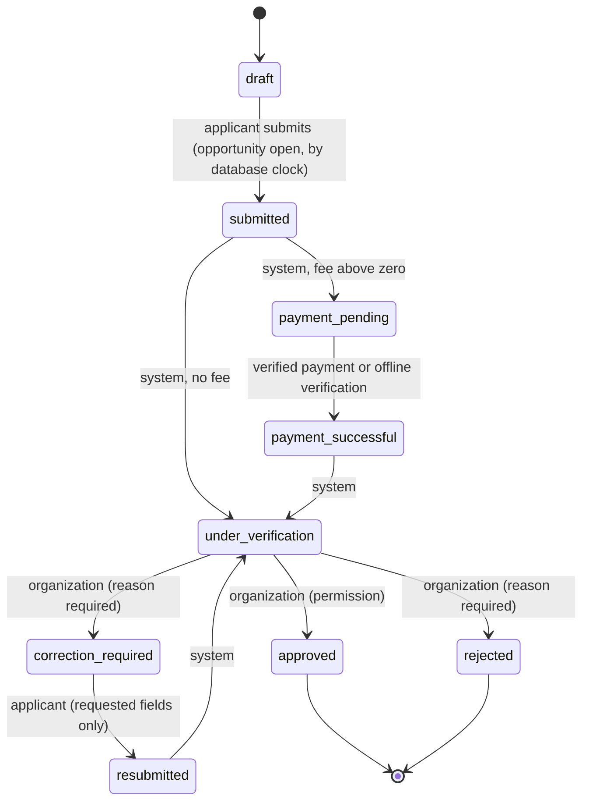
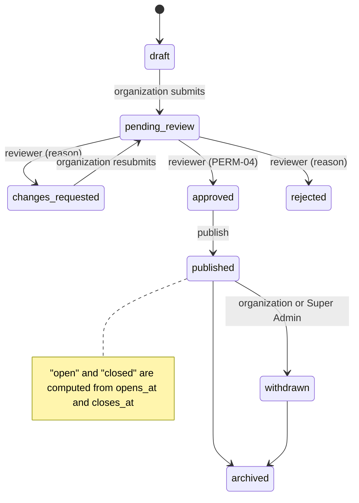
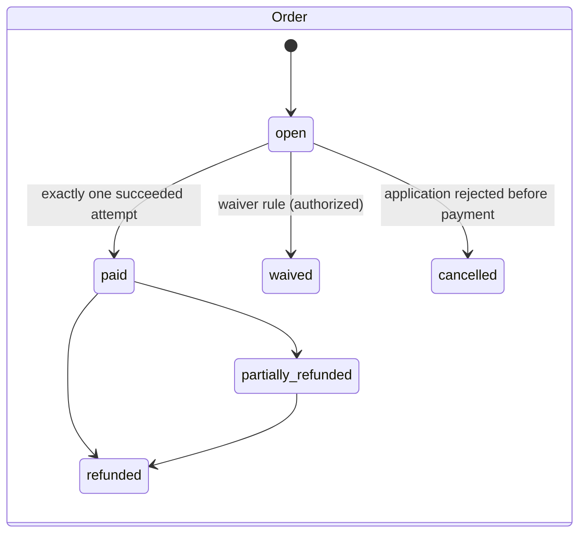
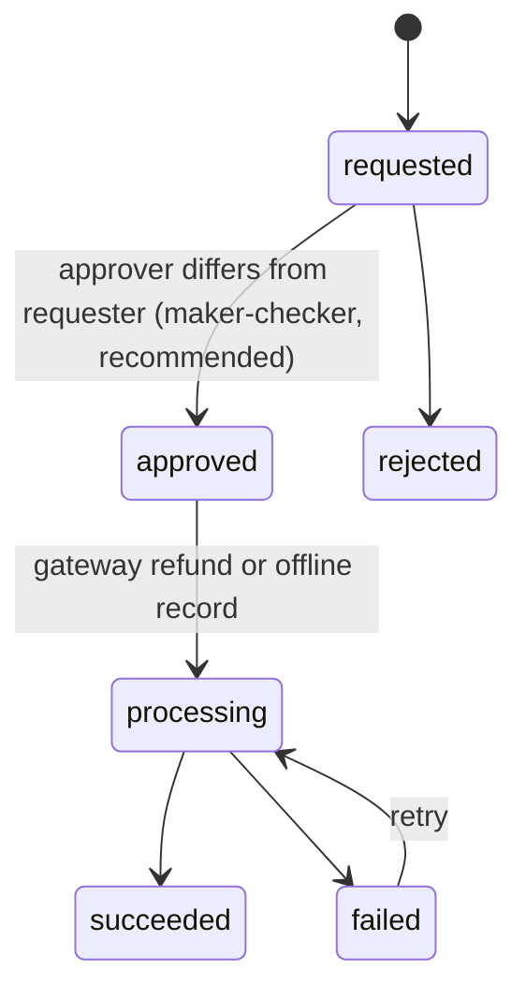

# ELTNOY data model: final proposal

**Status:** DESIGN PROPOSAL ONLY (P-09). No SQL has been run, no migration written and no table created. Internal only (P-20). Last updated 2026-11-03.
**Supersedes:** `opportunity-data-model-proposal.md` (revision 2), which is kept for history. Everything there is carried over, with the 2026-11-03 updates applied:
- N-01 (opportunity types);
- N-02 (organization types);
- N-03 (no subscriptions);
- the P0-3 policy A-01 to A-20;
- the conflict recommendations C-02, C-03 and C-16.

**Every recommendation that resolves a conflict is PENDING_CONFIRMATION.**

---

## 1. Ground rules

1. **Existing tables, columns, constraints and rows stay unchanged.** The only exceptions are the named items in §12.2, each needing explicit approval.
2. **New tables only** for the opportunity platform. Foreign keys *from* new tables *to* existing ones are additive.
3. **Every organization-owned row carries `organization_id`.** Composite foreign keys stop a child pointing at another organization's parent.
4. **Value lists that may change use seeded reference tables,** not CHECK lists, so changes stay additive (DB-04).
5. **History is append-only, enforced by triggers.** Corrections are new rows.
6. **Shared conventions:**
   - `text` IDs, `timestamptz`, money as `bigint` paise;
   - migrations in one transaction, safe to rerun, listed in `server/migrate.ts` (R-02).
7. **P0-4 is untouched:** `online_exam_*` and the legacy `applications.status = 'approved'` dependency (COMP-01).

---

## 2. Existing tables (unchanged unless listed in §12.2)

| Group | Tables | Role in the new model |
|---|---|---|
| Identity | `users`, `auth_sessions` | Every account (applicant = `candidate`, organization owner = `center`, Official / Super Admin = `official`, staff = `staff` if D-06 is approved). Sessions reused. |
| Institution onboarding | `institute_status_history`, `institute_resubmissions`, `institution_documents`, `institution_document_versions`, `institution_document_review_history`, `institution_submission_cycles`, `institution_submission_capabilities` | Organization approval (A-01). Reused as is. |
| Institution operations | `institute_forms`, `institute_profile_changes`, `institute_wallet_entries`, `institute_withdrawals` | Legacy forms stay (P-14). The wallet receives settlements (C-02). Withdrawals change under A-03 (§12.2). |
| Exam module | `exams`, `applications`, `admit_cards`, `answer_key_questions`, `online_exam_questions`, `online_exam_attempts`, `published_results`, `mock_exam_attempts`, `center_checkins` | Optional module (P-02), unchanged. Linked to opportunities by `exam_code`. |
| Content and support | `portal_notices`, `feedback` | Unchanged. Publishing permissions follow A-14 and A-17. |

---

## 3. Entity-relationship diagram (new tables and the existing tables they reference)

```mermaid
erDiagram
  users ||--o| organization_profiles : "organization (center) has profile"
  organization_types ||--o{ organization_profiles : classifies
  users ||--o{ organization_members : "organization has members"
  users ||--o{ organization_members : "staff user is member"
  organization_members ||--o{ organization_member_invitations : "activated by"
  users ||--o{ organization_roles : "organization defines"
  organization_roles ||--o{ organization_role_permissions : grants
  permission_catalogue ||--o{ organization_role_permissions : "drawn from"
  organization_members ||--o{ organization_member_roles : holds
  organization_roles ||--o{ organization_member_roles : "assigned via"
  organization_members ||--o{ organization_member_scopes : "limited by"

  users ||--o{ opportunities : "organization owns"
  opportunity_categories ||--o{ opportunities : categorizes
  opportunities ||--o{ opportunity_review_history : "reviewed in"
  opportunities ||--o{ opportunity_form_versions : "has versions"
  opportunities ||--o| opportunity_fees : "charges"
  opportunities ||--o{ opportunity_exam_links : "links"
  exams ||--o{ opportunity_exam_links : "linked exam"

  opportunities ||--o{ opportunity_applications : receives
  users ||--o{ opportunity_applications : "applicant submits"
  opportunity_form_versions ||--o{ opportunity_applications : "answered with"
  application_statuses ||--o{ opportunity_applications : "current status"
  opportunity_applications ||--|{ opportunity_application_versions : "snapshots"
  opportunity_applications ||--|{ opportunity_application_status_history : "history"
  opportunity_applications ||--o{ opportunity_correction_requests : "corrections"
  opportunity_applications ||--o{ opportunity_application_module_states : "module states"
  opportunity_application_versions ||--o{ opportunity_application_attachments : "attaches"
  applicant_files ||--o{ opportunity_application_attachments : "file"
  users ||--o{ applicant_files : "uploads"

  opportunity_applications ||--o{ opportunity_payment_orders : "owes"
  opportunity_payment_orders ||--o{ opportunity_payment_attempts : "tried by"
  payment_providers ||--o{ opportunity_payment_attempts : "via (gateway only)"
  opportunity_payment_attempts ||--o{ opportunity_payment_events : "confirmed by"
  opportunity_payment_orders ||--o{ opportunity_refunds : "refunded by"
  users ||--o{ opportunity_settlements : "organization receives"
  opportunity_settlements |o--o| institute_wallet_entries : "credited as"

  users ||--o{ audit_events : "actor"
  users ||--o{ notifications : "recipient"
  notifications ||--o{ notification_deliveries : "outbox (disabled)"
```

**How to read the cardinalities:**
- `||--o{` means one to zero-or-more.
- `||--|{` means one to one-or-more. A submitted application has at least one snapshot and one history row; a draft has history from creation.
- `||--o|` means one to zero-or-one.

---

## 4. Table inventory

**Phase key:**
- **1:** opportunity core;
- **1b:** staff, which needs D-06, D-07 and D-08;
- **P3:** the P0-3 completion;
- **later:** decided separately.

**Additive** means a new table, with no change to any existing table.

### 4.1 Reference tables (seeded with `INSERT … ON CONFLICT DO NOTHING`)

| Table | Primary key | Columns | Seed | Phase |
|---|---|---|---|---|
| `opportunity_categories` | `code` | `label`, `is_active`, `sort_order`, `requires_module` | `examination` (module `examination`), `scholarship`, `admission`, `vacancy`, `registration`, `custom` (N-01) | 1 |
| `organization_types` | `code` | `label`, `is_active` | `educational_institution`, `government_department`, `private_company`, `ngo`, `recruitment_organization`; `other` only if C-13 is approved | 1 |
| `application_statuses` | `code` | `label`, `is_final` | the 9 statuses of P-11 | 1 |
| `permission_catalogue` | `code` | `description`, `module` | D-08 list **minus `audit.view`** (C-03); `activity.view` only if C-03 is approved | 1b |
| `payment_providers` | `code` | `display_name`, `priority ∈ primary, backup`, `enabled` | **No rows** until P-16. Never any credentials. | 1 (empty) |

### 4.2 Organizations and staff

| Table | Primary key | Columns | Foreign keys | Unique and checks | Phase |
|---|---|---|---|---|---|
| `organization_profiles` | `organization_id` | `organization_type`, `public_slug`, `legal_name`, `public_description`, `city`, `state`, `created_at`, `updated_at` | `organization_id → users(id)` RESTRICT; `organization_type → organization_types(code)` | `UNIQUE (public_slug)`; the "is a center account" rule is enforced by the application or a trigger | 1 |
| `organization_members` | `id` | `organization_id`, `user_id`, `status ∈ invited, active, suspended, removed`, `verified_at`, `verified_by`, `verification_method`, `invited_by`, `created_at` | `organization_id`, `user_id`, `verified_by`, `invited_by → users(id)` RESTRICT | `UNIQUE (organization_id, user_id)`; `UNIQUE (id, organization_id)`; `CHECK (status <> 'active' OR verified_at IS NOT NULL)` | 1b |
| `organization_member_invitations` | `id` | `member_id`, `organization_id`, `token_hash` (SHA-256), `created_at`, `expires_at`, `used_at`, `revoked_at` | `(member_id, organization_id) → organization_members(id, organization_id)` | `UNIQUE (token_hash)`; one live invitation per member (partial unique); `CHECK (expires_at > created_at)` | 1b |
| `organization_roles` | `id` | `organization_id`, `name`, `description`, `created_by`, `created_at` | `organization_id → users(id)` | `UNIQUE (organization_id, name)`; `UNIQUE (id, organization_id)` | 1b |
| `organization_role_permissions` | `(role_id, permission_code)` | `organization_id` | `(role_id, organization_id) → organization_roles`; `permission_code → permission_catalogue(code)` | — | 1b |
| `organization_member_roles` | `(member_id, role_id)` | `organization_id`, `granted_by`, `granted_at` | `(member_id, organization_id) → organization_members`; `(role_id, organization_id) → organization_roles` | Members and roles always belong to the same organization | 1b |
| `organization_member_scopes` | `(member_id, scope_type, scope_value)` | `organization_id` | `(member_id, organization_id) → organization_members` | `scope_type ∈ exam_center` | later (D-09) |

### 4.3 Opportunities

| Table | Primary key | Columns | Foreign keys | Unique and checks | Phase |
|---|---|---|---|---|---|
| `opportunities` | `id` | `organization_id`, `reference_code`, `category_code`, `subtype`, `title`, `summary`, `description`, `eligibility`, `apply_mode ∈ in_platform, external_link`, `external_url`, `opens_at`, `closes_at`, `time_zone`, `status ∈ draft, pending_review, changes_requested, approved, published, rejected, withdrawn, archived`, `visibility ∈ public, unlisted`, `current_form_version_id`, `corrections_allowed`, `correction_window_days`, `created_by`, `created_at`, `updated_at`, `published_at` | `organization_id → users(id)` RESTRICT; `category_code → opportunity_categories`; `created_by → users` | `UNIQUE (reference_code)`; `UNIQUE (id, organization_id)`; `CHECK (closes_at > opens_at)`; `CHECK ((apply_mode = 'external_link') = (external_url IS NOT NULL))`; text length checks | 1 |
| `opportunity_review_history` (append-only) | `id` | `opportunity_id`, `organization_id`, `from_status`, `to_status`, `reviewer_user_id`, `reason`, `decided_at` | `(opportunity_id, organization_id) → opportunities` | A reason (10–1000 characters) is required when rejecting or requesting changes | 1 |
| `opportunity_form_versions` | `id` | `opportunity_id`, `organization_id`, `version_number`, `schema jsonb`, `schema_sha256`, `status ∈ draft, published, superseded`, `created_by`, `created_at`, `published_at` | `(opportunity_id, organization_id) → opportunities` | `UNIQUE (opportunity_id, version_number)`; `UNIQUE (id, opportunity_id, organization_id)`; immutable once published (trigger) | 1 |
| `opportunity_fees` | `opportunity_id` | `organization_id`, `amount_paise ≥ 0`, `currency = 'INR'`, `waiver_rules jsonb`, `refund_policy` | `(opportunity_id, organization_id) → opportunities` | — | 1 |
| `opportunity_exam_links` | `(opportunity_id, exam_code)` | `organization_id` | `(opportunity_id, organization_id) → opportunities`; `exam_code → exams(code)` | — | later (D-29) |

`opportunities.current_form_version_id` gets a deferrable foreign key to `opportunity_form_versions(id)`, added once both tables exist.

### 4.4 Applications

| Table | Primary key | Columns | Foreign keys | Unique and checks | Phase |
|---|---|---|---|---|---|
| `opportunity_applications` | `id` | `application_number`, `opportunity_id`, `organization_id`, `applicant_user_id`, `form_version_id`, `status`, `answers jsonb`, `current_version_number`, `created_at`, `updated_at`, `submitted_at`, `status_changed_at` | `(opportunity_id, organization_id) → opportunities`; `(form_version_id, opportunity_id, organization_id) → opportunity_form_versions`; `applicant_user_id → users(id)` RESTRICT; `status → application_statuses(code)` | `UNIQUE (application_number)` (format D-13; must not collide with legacy numbers); `UNIQUE (id, organization_id)`; **`UNIQUE (opportunity_id, applicant_user_id)`**, one per applicant (recommended; more than one isn't approved); answer-size check (D-12) | 1 |
| `opportunity_application_versions` (append-only) | `(application_id, version_number)` | `organization_id`, `form_version_id`, `answers jsonb`, `answers_sha256`, `reason ∈ initial, correction_response`, `submitted_by`, `submitted_at` | `(application_id, organization_id) → opportunity_applications(id, organization_id)` | — | 1 |
| `opportunity_application_status_history` (append-only) | `id` | `application_id`, `organization_id`, `from_status`, `to_status`, `actor_user_id`, `actor_kind ∈ applicant, organization, staff, super_admin, official, system`, `reason`, `decided_at` | `(application_id, organization_id) → opportunity_applications`; statuses → `application_statuses` | A reason is required for `correction_required` and `rejected` | 1 |
| `opportunity_correction_requests` | `id` | `application_id`, `organization_id`, `requested_by`, `field_keys text[]`, `message`, `due_at`, `status ∈ open, responded, expired, cancelled`, `response_version_number`, `created_at` | `(application_id, organization_id) → opportunity_applications` | At most one open request per application (partial unique) | 1 |
| `opportunity_application_module_states` | `(application_id, module_code)` | `organization_id`, `state`, `updated_at` | `(application_id, organization_id) → opportunity_applications` | Owned by the module that sets it (P-11) | later |

### 4.5 Documents

| Table | Primary key | Columns | Foreign keys | Unique and checks | Phase |
|---|---|---|---|---|---|
| `applicant_files` (append-only) | `id` | `owner_user_id`, `storage_key` (UUID), `detected_media_type ∈ application/pdf, image/jpeg, image/png`, `file_size_bytes`, `content_sha256`, `uploaded_at` | `owner_user_id → users(id)` RESTRICT | `UNIQUE (storage_key)` | 1 |
| `opportunity_application_attachments` | `(application_id, version_number, field_key, file_id)` | `organization_id` | `(application_id, version_number) → opportunity_application_versions`; `(application_id, organization_id) → opportunity_applications`; `file_id → applicant_files` | The file owner must be the applicant (trigger). **No reuse across applications** until P-12 is decided: the application refuses a file already attached to another application. | 1 |

### 4.6 Payments, refunds and settlement

| Table | Primary key | Columns | Foreign keys | Unique and checks | Phase |
|---|---|---|---|---|---|
| `opportunity_payment_orders` | `id` | `application_id`, `organization_id`, `amount_paise > 0`, `currency`, `status ∈ open, paid, partially_refunded, refunded, waived, cancelled`, `created_at`, `paid_at` | `(application_id, organization_id) → opportunity_applications` | At most one `open` order per application (partial unique) | 1 |
| `opportunity_payment_attempts` | `id` | `order_id`, `method ∈ offline_verified, gateway`, `provider_code`, `provider_order_ref`, `idempotency_key`, `status ∈ created, pending, succeeded, failed, expired`, `recorded_by`, `created_at`, `updated_at` | `order_id → opportunity_payment_orders`; `provider_code → payment_providers(code)`; `recorded_by → users` | `UNIQUE (idempotency_key)`; **at most one success per order** (`UNIQUE (order_id) WHERE status = 'succeeded'`); `CHECK ((method = 'gateway') = (provider_code IS NOT NULL))`; offline attempts need `recorded_by` | 1 (offline only) |
| `opportunity_payment_events` (append-only) | `id` | `provider_code`, `provider_event_id`, `attempt_id`, `event_type`, `signature_verified`, `payload_sha256`, `received_at` | `provider_code → payment_providers`; `attempt_id → opportunity_payment_attempts` | `UNIQUE (provider_code, provider_event_id)`. **No raw payload is stored** (it may hold personal data). | later (P-16) |
| `opportunity_refunds` | `id` | `order_id`, `organization_id`, `amount_paise > 0`, `reason`, `status ∈ requested, approved, rejected, processing, succeeded, failed`, `requested_by`, `approved_by`, `processed_by`, `provider_refund_ref`, timestamps | `order_id → opportunity_payment_orders` | Maker-checker `CHECK (approved_by IS NULL OR approved_by <> requested_by)` (recommended, M-07); total refunds can't exceed what was paid (enforced in the transaction) | later (M-07) |
| `opportunity_settlements` | `id` | `organization_id`, `amount_paise`, `period_start`, `period_end`, `status ∈ proposed, approved, credited, rejected`, `proposed_at`, `approved_by`, `approved_at`, `wallet_entry_id` | `organization_id → users`; `approved_by → users`; `wallet_entry_id → institute_wallet_entries(id)` | `UNIQUE (wallet_entry_id)`. Crediting needs **Super Admin approval** (A-02, C-02, pending). | later |

### 4.7 Audit and notifications

| Table | Primary key | Columns | Foreign keys | Notes | Phase |
|---|---|---|---|---|---|
| `audit_events` (append-only) | `id` | `occurred_at`, `request_id`, `actor_user_id`, `actor_kind`, `organization_id`, `action`, `entity_type`, `entity_id`, `before_state jsonb`, `after_state jsonb`, `metadata jsonb` | `actor_user_id → users` (nullable for `system`) | **Shared by P0-3 (A-11) and the opportunity platform.** Written in the same transaction as the action. Readable by Super Admin only (A-12). No automatic deletion (A-13). The before and after states hold changed fields only, never secrets, answers or unnecessary personal data. | **P3** |
| `notifications` | `id` | `recipient_user_id`, `kind`, `entity_type`, `entity_id`, `title`, `body`, `created_at`, `read_at` | `recipient_user_id → users` | In-app only (P-17) | 1 |
| `notification_deliveries` | `id` | `notification_id`, `channel ∈ email, sms`, `status`, `attempts`, `next_attempt_at`, `last_error_code` | `notification_id → notifications` | **No rows are written** until P-18 is approved | later |

---

### 4.8 Examination Session Management (C-20, Option C; design only)

The full design, with its ER diagram, keys, indexes, lifecycle and authorization, is in [`examination-session-module.md`](examination-session-module.md) §3–§6. **All 13 tables are new; no existing table changes:**
- `exam_centers`
- `exam_sessions`
- `exam_session_status_history` (append-only)
- `exam_session_centers`
- `exam_session_roles` and `exam_session_role_permissions` (seeded reference tables)
- `exam_session_assignments`
- `exam_session_assignment_events` (append-only)
- `exam_session_candidates`
- `exam_session_allocation_events` (append-only)
- `exam_session_attendance_events` (append-only)
- `exam_session_incidents`
- `exam_session_incident_events` (append-only)

**Foreign keys to existing tables** (additive): `exams(code)`, `applications(id)`, `users(id)`, and later `opportunity_applications(id)`.

**Unchanged legacy tables:** `exams.shifts` (never parsed), `admit_cards` and `center_checkins`.

## 5. Index strategy

**Principles:**
- Index the columns that queries filter on.
- Every list query is limited (paged) and ordered by an indexed column.
- No index without a known query.

| Query | Index |
|---|---|
| Public list of open opportunities | `opportunities (status, opens_at, closes_at)` with `WHERE status = 'published'`; `(category_code, closes_at)` |
| Organization's own opportunities | `opportunities (organization_id, created_at DESC)` |
| Organization's applications inbox, by status | `opportunity_applications (organization_id, status, status_changed_at DESC)` |
| Applications to one opportunity | `opportunity_applications (opportunity_id, status)` |
| Applicant's own applications | `opportunity_applications (applicant_user_id, created_at DESC)` |
| History timelines | `status_history (application_id, decided_at)`; `review_history (opportunity_id, decided_at)` |
| Open payment orders and reconciliation | `payment_orders (status, created_at)` with `WHERE status = 'open'`; `payment_attempts (order_id)` |
| Unread notifications | `notifications (recipient_user_id, created_at DESC)` with `WHERE read_at IS NULL` |
| Audit viewer | `audit_events (occurred_at DESC)`, `(entity_type, entity_id)`, `(organization_id, occurred_at DESC)`, `(actor_user_id, occurred_at DESC)` |
| Staff permission check | `organization_members (user_id)` with `WHERE status = 'active'`; `organization_member_roles (member_id)` |
| Answer search (only if a report needs it) | GIN on `opportunity_applications.answers` with `jsonb_path_ops`. Not created by default. |

---

## 6. Tenant isolation

1. **In the database:** composite foreign keys on `(…, organization_id)` throughout (§4). A child row can't reference a parent belonging to another organization.
2. **In the application:** one authorization helper resolves the actor and organization **from the session**, never from the request, and returns 403 by default. It extends the P0-3 pattern in `authorizationQueries.ts`.
3. **Tests:** a cross-organization test suite. Organization A, holding every permission, gets 403 or 404 on every route for organization B's data.
4. **Later:** PostgreSQL row-level security (D-31), not in Phase 1, because the app connects as a single database role.

---

## 7. Role and permission model

| Actor | Identity | Authority |
|---|---|---|
| Applicant | `users.role = 'candidate'` | Own profile, own applications, own files |
| Organization owner | `users.role = 'center'`, `account_status = 'approved'` | Every organization permission for their own organization |
| Organization staff | `users.role = 'staff'` (D-06) plus an active, verified membership (D-07) | The union of their roles' permissions, from the catalogue (D-08), narrowed by scopes (D-09). **Never** platform authority. |
| Official | `users.role = 'official'` | A-01 (institution approval), A-08 (applications, without email or phone), A-17 (draft notices), A-18 (exams and draft imports). New-platform rights are D-10. |
| Super Admin | `official` plus `is_super_admin` | A-02 to A-07, A-09, A-10, A-12, A-14 to A-17. Opportunity publishing approval is PERM-04. |
| System | — | Status changes after payment and resubmission (D-16), P0-4 recovery, notifications |

**Never grantable to an organization role:**
- approving organizations;
- approving and publishing opportunities;
- wallet credits, withdrawals and settlements;
- platform settings and categories;
- the audit log (A-12);
- Official management;
- other organizations' data.

**Escalation guards:**
- A member can't grant a permission they don't hold.
- A member can't change their own roles.
- A member can't widen a role they hold.
- Every change is audited.

---

## 8. Application status lifecycle

The status set is P-11 (approved). The transitions are **D-16, PENDING_CONFIRMATION**.

**Open questions** (the gap register, §7): a correction requiring a new payment; whether `submitted` and `resubmitted` persist; an expired correction deadline; unpaid applications at closing time; fee changes.

> **Superseded in part (C-21).** The confirmed decisions Q120, Q121, Q123 and Q125 replace "approved and rejected are final". They require:
> - appeal to the Owner within a configured deadline (Q120, Q122);
> - Owner override of a rejection (Q121);
> - Owner reopening after the deadline (Q123);
> - withdrawal within a deadline, plus Owner-decided exceptions (Q124);
> - withdrawal requests after approval (Q125).
>
> How appeals and withdrawal are represented, as statuses or as separate records, is C-19 (pending). The diagram above will be revised once C-19 is decided.

**Opportunity lifecycle** (D-26 and D-27 pending):

---

## 9. Payment and refund lifecycle

**Payment** (P-15 approved; providers P-16 pending; Phase 1 is offline only):

- **Attempt states:** `created → pending → succeeded | failed | expired`.
- **Failover:** when the primary provider fails or is unavailable, a new attempt is made with the backup.
- **A second success** on an already-paid order is flagged for refund and never counted twice.
- **Offline payments:** an attempt with `method = offline_verified`, recorded by a permitted member and audited.

**Refunds** (M-07 pending):

**Settlement** (C-02 pending): periodic `opportunity_settlements` are proposed by the system and approved by Super Admin. They are then credited to `institute_wallet_entries` in one transaction with an audit event. Withdrawals continue under A-03.

---

## 10. Audit and event history

| History | Table | Written by |
|---|---|---|
| Platform audit (all important actions) | `audit_events` | Every financial, approval, publishing, permission and document-access action, in the same transaction (A-11) |
| Opportunity reviews | `opportunity_review_history` | Reviewers |
| Application status | `opportunity_application_status_history` | Each status change |
| Application content | `opportunity_application_versions` | Each submission and resubmission |
| Payment provider events | `opportunity_payment_events` | Verified callbacks |
| Existing histories | `institute_status_history`, `institute_resubmissions`, institution document tables | Unchanged |
| P0-4 finalization | `score.completion` plus logs (R-09) | Unchanged. A matching `audit_events` row needs approval (C-10). |

**Organization activity history** (C-03, pending): a filtered, read-only view of `audit_events` for the organization's own staff actions, under a separate permission. It is never the platform audit log.

---

## 11. Migration and rollback strategy

1. **One migration file per milestone,** added to the fixed list in `server/migrate.ts`. Each runs in one transaction, can be safely rerun (`IF NOT EXISTS`, guarded blocks) and follows the R-02 pattern.
2. **Isolated validation first** (Phase 7 rules: disposable PostgreSQL 17, no host port 5432, synthetic data):
   - the migration runs twice;
   - every existing table's definition is byte-identical before and after (except the approved items in §12.2);
   - the triggers, the cross-organization foreign-key rejections and the seed data are checked.
3. **Feature flag** (D-01) off by default. Rollback means turning the flag off. New tables stay, unused.
4. **No `DROP` in any production plan.** Dropping is only for disposable databases.
5. **One-way changes** (§12.2 X-01) are documented as such and rehearsed. The restore procedure (M-10) is validated before any production migration.
6. **Production** needs separate authorization (S-01, R-11).
7. **Order:**
   - P3 audit and P0-3 columns (milestone 3);
   - opportunity core (milestones 4–6);
   - documents (milestone 7);
   - payments (milestone 8, offline only);
   - staff (milestone 9, after X-01);
   - notifications (milestone 10).

---

## 12. Additive changes versus changes needing approval

### 12.1 Additive (new tables only; still need the milestone approval)

Every table in §4, including the 13 examination-session tables in §4.8. Foreign keys *from* new tables to existing ones count as additive, for example `opportunity_exam_links.exam_code → exams(code)`, `opportunity_settlements.wallet_entry_id → institute_wallet_entries(id)`, `exam_sessions.exam_code → exams(code)` and `exam_session_candidates.legacy_application_id → applications(id)`.

### 12.2 Changes to existing tables (each needs separate, explicit approval)

| ID | Change | Why | Risk | Status |
|---|---|---|---|---|
| X-01 | `users.role` CHECK gains `staff` | D-06 | Locks the table; **one-way** once staff rows exist (DB-01) | PENDING_CONFIRMATION (C-04) |
| X-02 | `users`: a database rule blocking `role = 'staff' AND account_status = 'approved'` without a verified membership (trigger) | C-16 | A trigger on a busy table | PENDING_CONFIRMATION |
| X-03 | `users`: `CHECK (is_super_admin = false OR role = 'official')` | SEC-10 | Fails if any existing row violates it; a read-only check on a copy is needed first | PENDING_CONFIRMATION (optional) |
| X-04 | `institute_withdrawals`: approver and payer columns, plus a constraint that payer ≠ approver, including legacy rows | A-03 | Backfilling legacy approvers (the 03:22Z plan) | DISCUSSION_APPROVED (policy); plan awaiting final review |
| X-05 | `admit_cards`: draft/published state | A-06, A-16 | Old code ignores it, so no mixed-version deployment (A-20) | DISCUSSION_APPROVED (policy); plan awaiting final review |
| X-06 | `published_results`: correction returns the result to draft; publisher recorded | A-04, A-16 | Existing `is_published` semantics | DISCUSSION_APPROVED (policy); plan awaiting final review |
| X-07 | `portal_notices`: who published it (if needed for A-17) | A-17 | Low | DISCUSSION_APPROVED (policy) |
| X-08 | P0-4 writes a matching `audit_events` row | C-10 | Changes accepted P0-4 code (R-04) | PENDING_CONFIRMATION |

---

## 13. Decision register for this model

| ID | Decision | Status | Note |
|---|---|---|---|
| D-01 | Feature-flag name and default | PENDING_CONFIRMATION | Recommended: `OPPORTUNITIES_ENABLED=false` |
| D-02 | Visibility beyond public and unlisted | PENDING_CONFIRMATION | — |
| D-03 | Super Admin-managed categories versus a fixed list | PENDING_CONFIRMATION | The reference table supports either |
| D-04 | Government and private as categories or as an organization attribute | PENDING_CONFIRMATION | **Recommended:** organization attribute (N-01, N-02, C-12) |
| D-05 | Staff accounts (direction) | DISCUSSION_APPROVED | — |
| D-06 | `staff` in `users.role` (X-01) | PENDING_CONFIRMATION | C-04, C-16, DB-01 |
| D-07 | Staff verification method | PENDING_CONFIRMATION | **Recommended:** owner-issued activation code plus optional Super Admin confirmation (C-11) |
| D-08 | Permission catalogue and templates | PENDING_CONFIRMATION | **Recommended:** catalogue table; drop `audit.view` (C-03) |
| D-09 | Invigilator scopes | **DECIDED by Q117** (assigned examination sessions); session model **DISCUSSION_APPROVED** (C-20, Option C) | §4.8 and `examination-session-module.md`; the earlier `organization_member_scopes(exam_center)` is superseded by session assignments |
| D-10 | What non-super Officials may do on the new platform | PENDING_CONFIRMATION | **Recommended:** extend A-08 by analogy (list and status, no contact details) |
| D-11 | Named validation formats | PENDING_CONFIRMATION | — |
| D-12 | Form size limits | PENDING_CONFIRMATION | — |
| D-13 | Application number format | PENDING_CONFIRMATION | Must not collide with legacy numbers |
| D-14 | Draft expiry | PENDING_CONFIRMATION | — |
| D-15 | Status set | DISCUSSION_APPROVED | The same as P-11 |
| D-16 | Status transitions | PENDING_CONFIRMATION | §8; 8 open questions |
| D-17 | Withdrawal | PENDING_CONFIRMATION | — |
| D-18 | File reuse across applications | PENDING_CONFIRMATION (don't implement) | The same as P-12 |
| D-19 | Retention and deletion | PENDING_CONFIRMATION (don't implement) | The same as P-13 |
| D-20 | Original file names | PENDING_CONFIRMATION | — |
| D-21 | Primary and backup gateways | DISCUSSION_APPROVED | The same as P-15 |
| D-22 | Provider selection | PENDING_CONFIRMATION (client approval) | The same as P-16 |
| D-23 | Platform commission | PENDING_CONFIRMATION | No subscriptions (N-03); M-08 |
| D-24 | In-app notifications | DISCUSSION_APPROVED | The same as P-17 |
| D-25 | Email and SMS providers | PENDING_CONFIRMATION | The same as P-18 |
| D-26 | Editing after publishing | PENDING_CONFIRMATION | — |
| D-27 | Publishing without review | PENDING_CONFIRMATION | Relates to A-05 and PERM-04 |
| D-28 | Module enablement per organization | PENDING_CONFIRMATION | — |
| D-29 | Exam bridge to legacy applications | PENDING_CONFIRMATION | Deferred (COMP-01) |
| D-30 | `institute_forms` backfill | PENDING_CONFIRMATION (don't implement) | The same as P-14 |
| D-31 | Row-level security | PENDING_CONFIRMATION | — |
| D-32 | One application per applicant per opportunity (`UNIQUE (opportunity_id, applicant_user_id)`) | PENDING_CONFIRMATION | **New.** Recommended, matching the legacy rule. |
| D-33 | Refund approval with maker-checker | PENDING_CONFIRMATION | **New.** M-07. |
| D-34 | Settlement credits need Super Admin approval | PENDING_CONFIRMATION | **New.** C-02. |
