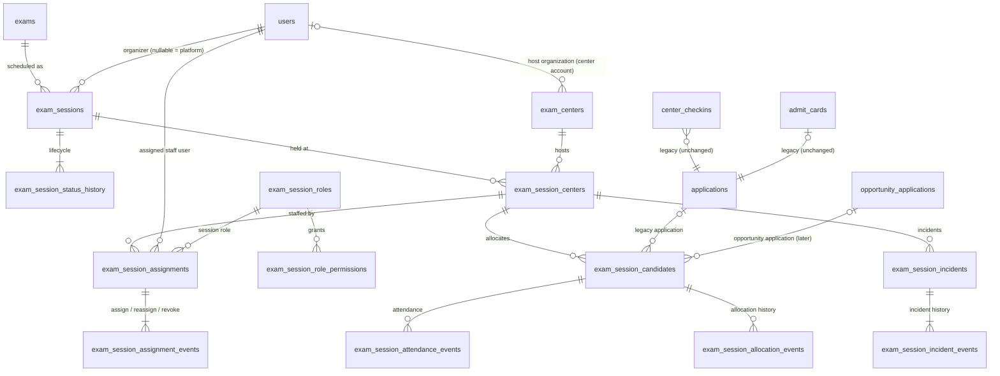

# Examination Session Management module: design and implementation plan

**Status:** DESIGN PROPOSAL. Documentation only. No SQL run, no migration, no code, Docker or Git change. Internal only. Prepared 2026-11-03.

**Authority:**
- Conflict **C-20** (invigilators limited to "assigned examination sessions", Q117, but no session record exists) is **DISCUSSION_APPROVED with Option C**: a structured Examination Session Management module covering the ten capabilities listed in §1.
- **Schema implementation needs separate approval** (§11).

**Related:**
- `../policy/master-policy-register.md`: Q117, Q115/Q116, A-05, A-06, A-18, P-02, R-10, E-02;
- `../policy/policy-conflict-and-gap-register.md`: C-18, C-20, C-22;
- `data-model-final-proposal.md` §4.8;
- `system-architecture.md` §5.13.

**Note on "Option C":** the register previously gave C-20 a single recommendation, not options A, B and C. Option C is recorded here as defined by the client's instruction of 2026-11-03 (the ten capabilities below), and nothing more is assumed.

---

## 1. Scope and mandatory rules

**Capabilities:**
1. Structured examination sessions.
2. Multiple invigilators per session.
3. Multiple assigned examination centers.
4. Session-specific role permissions.
5. Candidate allocation.
6. QR and manual attendance.
7. Session monitoring.
8. Emergency pause and incident reporting.
9. Assignment and reassignment audit history.
10. Session-wise reports.

**Mandatory rules, and how this design meets each:**

| Rule | How it's met |
|---|---|
| Invigilators can access only assigned sessions | Every invigilator query is scoped by an **active assignment** (session plus center) resolved from the session (§5) |
| Enforced by backend authorization | One `requireSessionAccess(permission)` guard per route; frontend only reflects it; matrix tests (§9) |
| Assignment and reassignment require authorized permissions | `exam.session.assign` (§5); every change is an append-only event with actor and reason (§6) |
| Preserve existing examination workflows | No existing table changes. `exams`, `applications`, `admit_cards`, `center_checkins`, `online_exam_*` and their routes keep working unchanged (§10) |
| No silent migration of free-text exam shifts | `exams.shifts` is never parsed into sessions. Sessions are created explicitly. An optional mapping **report** only proposes; a person approves each mapping (§10.3) |
| Preserve existing center-based attendance records | `center_checkins` is untouched and keeps working through `/api/center/checkins`. Session attendance is a separate table, and reports show legacy check-ins labelled as legacy (§10.2) |
| Backward compatibility and data mapping | §10 |
| Optional and modular | Module flag `EXAM_SESSIONS_ENABLED` (default off), plus per-organization enablement (D-28). Exams without sessions behave exactly as today. |
| No exposure of student data across unauthorized centers | Candidate lists, attendance and incidents are always filtered by `(session_id, center_id)` within the actor's assignment. The fields shown are a minimal set (§7.4). |

---

## 2. Concepts

| Concept | Meaning |
|---|---|
| **Exam** | An existing `exams` row (code, name, date, free-text `shifts`). Unchanged. |
| **Examination session** | One scheduled sitting of one exam: date, start and end times, reporting and gate-closing times, time zone, mode (`center_based`, `online_cbt`, `hybrid`). An exam can have many sessions (the structured replacement for free-text shifts, **added beside them, not in place of them**). |
| **Examination center** | A venue. Linked to the existing center account where one exists (`exam_centers.center_code` = the code used in `admit_cards.center_code`, which today equals the center account's `login_id`). |
| **Session center** | A center taking part in a session, with its own capacity and status. |
| **Session assignment** | A staff account assigned to a session at one center, with a session role. |
| **Candidate allocation** | A candidate (a legacy application or, later, an opportunity application) placed in a session at a center, with an optional seat. |
| **Attendance** | Present, absent and similar records for an allocated candidate, captured by QR or manually. |
| **Incident** | A reported event during a session (disruption, malpractice, technical failure, emergency). |

---

## 3. Entity-relationship diagram

Existing tables (`exams`, `applications`, `admit_cards`, `center_checkins`, `users`) are **only referenced**, never altered.

---

## 4. Data model (all new tables, all additive)

All tables use `text` IDs and `timestamptz`, run in one transaction, are safe to rerun, and are append-only where marked (trigger-enforced).

| Table | Primary key | Columns | Foreign keys | Unique and checks |
|---|---|---|---|---|
| `exam_centers` | `id` | `center_code`, `name`, `address`, `city`, `default_capacity`, `host_organization_id`, `status ∈ active, inactive`, `created_by`, `created_at` | `host_organization_id → users(id)` (center account, nullable); `created_by → users` | `UNIQUE (center_code)`. `center_code` must equal the legacy `admit_cards.center_code` text where one exists (§10.1). |
| `exam_sessions` | `id` | `session_code`, `exam_code`, `organizer_organization_id` (NULL = platform-run), `title`, `mode ∈ center_based, online_cbt, hybrid`, `starts_at`, `ends_at`, `reporting_at`, `gate_closes_at`, `time_zone`, `status` (§6), `legacy_shift_label` (informational copy, never parsed), `created_by`, `created_at`, `updated_at` | `exam_code → exams(code)`; `organizer_organization_id → users(id)`; `created_by → users` | `UNIQUE (session_code)`; `CHECK (ends_at > starts_at)`; `CHECK (reporting_at <= starts_at)`; `CHECK (gate_closes_at BETWEEN reporting_at AND ends_at)` |
| `exam_session_status_history` (append-only) | `id` | `session_id`, `from_status`, `to_status`, `actor_user_id`, `reason`, `decided_at` | `session_id → exam_sessions` | A reason is required for `paused`, `cancelled`, and resuming after a pause |
| `exam_session_centers` | `(session_id, center_id)` | `capacity`, `status ∈ active, paused, closed`, `paused_at`, `paused_reason` | `session_id → exam_sessions`; `center_id → exam_centers` | `CHECK (capacity > 0)`. Center-level pause is allowed (§6.2). |
| `exam_session_roles` (reference, seeded) | `code` | `label`, `description` | — | Proposed: `chief_invigilator`, `invigilator`, `attendance_operator`, `observer` (**ES-D1**) |
| `exam_session_role_permissions` (reference, seeded) | `(role_code, permission_code)` | — | `role_code → exam_session_roles` | Permission codes from §5.2 |
| `exam_session_assignments` | `id` | `session_id`, `center_id`, `user_id`, `role_code`, `status ∈ active, revoked`, `assigned_by`, `assigned_at`, `revoked_by`, `revoked_at` | `(session_id, center_id) → exam_session_centers`; `user_id → users`; `role_code → exam_session_roles` | **One active assignment per user per session** (partial unique `(session_id, user_id) WHERE status = 'active'`). Many invigilators per session and center are allowed. |
| `exam_session_assignment_events` (append-only) | `id` | `assignment_id`, `event ∈ assigned, reassigned, role_changed, revoked`, `from_center_id`, `to_center_id`, `from_role`, `to_role`, `actor_user_id`, `reason`, `occurred_at` | `assignment_id → exam_session_assignments` | A reason is required for `reassigned`, `role_changed` and `revoked` |
| `exam_session_candidates` | `id` | `session_id`, `center_id`, `legacy_application_id`, `opportunity_application_id`, `roll_number`, `seat_label`, `status ∈ allocated, moved, cancelled`, `allocated_by`, `allocated_at` | `(session_id, center_id) → exam_session_centers`; `legacy_application_id → applications(id)`; `opportunity_application_id → opportunity_applications(id)` (only after that table exists) | `CHECK (num_nonnulls(legacy_application_id, opportunity_application_id) = 1)`; one allocation per candidate per session (partial unique on each reference); `UNIQUE (session_id, center_id, seat_label)`; centers can't be over capacity (checked in the transaction) |
| `exam_session_allocation_events` (append-only) | `id` | `session_candidate_id`, `event ∈ allocated, moved, cancelled`, `from_center_id`, `to_center_id`, `actor_user_id`, `reason`, `occurred_at` | → `exam_session_candidates` | A reason is required for `moved` and `cancelled` |
| `exam_session_attendance_events` (append-only) | `id` | `session_candidate_id`, `session_id`, `center_id`, `status ∈ present, absent, late, denied_entry, left_early` (**ES-D6**), `method ∈ qr, manual`, `recorded_by`, `recorded_at`, `note`, `supersedes_event_id` | → `exam_session_candidates`; `recorded_by → users` | **The latest event is the current status.** Corrections are new events pointing at the one they replace. **Only one `present` per candidate per session** (partial unique), so a double QR scan can't create a duplicate. |
| `exam_session_incidents` | `id` | `session_id`, `center_id`, `category` (**ES-D8**), `severity ∈ low, medium, high, critical`, `summary`, `session_candidate_id` (optional), `status ∈ open, acknowledged, resolved`, `reported_by`, `reported_at` | `(session_id, center_id) → exam_session_centers`; → `exam_session_candidates`; `reported_by → users` | `summary` is limited in length; **free text must not repeat candidate personal data** (UI guidance plus review) |
| `exam_session_incident_events` (append-only) | `id` | `incident_id`, `event ∈ reported, acknowledged, note_added, resolved, reopened`, `actor_user_id`, `note`, `occurred_at` | → `exam_session_incidents` | — |

**Indexes:**
- `exam_sessions (exam_code, starts_at)`, `(status, starts_at)`;
- `exam_session_assignments (user_id) WHERE status = 'active'` (the invigilator's "my sessions" view);
- `exam_session_candidates (session_id, center_id)`;
- `exam_session_attendance_events (session_candidate_id, recorded_at DESC)`;
- `exam_session_incidents (session_id, status)`.

**QR tokens need no table.** A QR code carries a signed, expiring token `{session_candidate_id, session_id, exp}`, signed with HMAC-SHA-256 using a key from the environment. The key is never stored in the database or logged. Replay is harmless because of the one-`present` rule.

---

## 5. Authorization

### 5.1 Who can act

| Actor | How access is granted | Scope |
|---|---|---|
| Super Admin | `official` with `is_super_admin` | All sessions. Publishing and scheduling for **platform-run** exams (A-05 by analogy, **ES-D3**). |
| Ordinary Official | `official` | Platform-run sessions: create and edit drafts (A-18 by analogy); no publishing (ES-D3); no candidate personal data beyond the A-08 limits |
| Organizer organization owner | `center` owning `organizer_organization_id` | Their organization's sessions (organization-run exams, with D-28) |
| Organization staff with a permission | Staff (D-06; onboarding blocked by C-18) holding an organization permission (D-08 catalogue) such as `exam.session.manage` or `exam.session.assign` | Their organization's sessions |
| **Invigilator and other session roles** | **An active `exam_session_assignments` row** for (session, center), with a session role (Q117) | **Only the assigned session and center**, only the permissions of that session role, and only while the session is in an allowed status (§6) |
| Host center account (legacy path) | `center` whose `login_id` equals `exam_centers.center_code` | Existing `/api/center/checkins` unchanged. Recording session attendance as a center account is **ES-D11**. |
| Candidate | `candidate` | Own allocation (session, center, seat, times) and own QR token |

### 5.2 Permission codes (session-level, granted by session role; ES-D1)

| Permission | chief_invigilator | invigilator | attendance_operator | observer |
|---|---|---|---|---|
| `session.view` (own assignment) | ✅ | ✅ | ✅ | ✅ |
| `session.candidates.view` (own center, minimal fields) | ✅ | ✅ | ✅ | ❌ |
| `session.attendance.record` (QR and manual) | ✅ | ✅ | ✅ | ❌ |
| `session.attendance.correct` (supersede an event) | ✅ | ❌ | ❌ | ❌ |
| `session.incident.report` | ✅ | ✅ | ❌ | ✅ |
| `session.incident.manage` (acknowledge, resolve) | ✅ | ❌ | ❌ | ❌ |
| `session.center.pause_request` (emergency pause at their center) | ✅ | ❌ | ❌ | ❌ |
| `session.monitor` (live counts for own center) | ✅ | ✅ | ❌ | ✅ |

**Management permissions** (organization or platform level, **never** granted by a session role):
- `exam.session.manage` (create, edit, schedule);
- `exam.session.assign` (assign, reassign, revoke staff);
- `exam.session.allocate` (candidate allocation);
- `exam.session.pause` (pause or resume the whole session);
- `exam.session.reports` (session reports).

Platform-run sessions use Official and Super Admin roles (ES-D3). Session roles can never carry Super Admin or management permissions (Q117: "Super Admin permissions cannot be delegated").

### 5.3 Enforcement

- **One guard, `requireSessionAccess(permission)`:**
  1. resolves the actor from the session cookie;
  2. loads the actor's active assignment for `:sessionId` (and `:centerId` where relevant);
  3. checks the role permission and the session status;
  4. returns 403 when any of these fails.

  Management routes use organization permissions or the Official / Super Admin checks.
- **Every query carries `session_id` and `center_id` from the resolved assignment, never from the request body.**
- When an assignment is revoked, access ends at once (checked on every request; no cached grants).

### 5.4 API and authorization matrix (proposed)

Key: SA = Super Admin; O = ordinary Official; OrgM = organizer owner or staff with the management permission; SR = a session role holding the permission; C = candidate (self only).

| Method and route | Purpose | Allowed |
|---|---|---|
| `POST /api/exam-sessions` | Create a draft session | SA, O (platform); OrgM (organization) |
| `PATCH /api/exam-sessions/:id` | Edit a draft or scheduled session | SA, O for drafts; OrgM |
| `POST /api/exam-sessions/:id/transition` | Lifecycle change (§6) | Schedule or publish: SA (platform, ES-D3), OrgM. Pause or resume: SA, OrgM (`exam.session.pause`). Cancel: SA, OrgM. |
| `GET /api/exam-sessions` | List (filtered by scope) | SA, O; OrgM (own); SR (assigned only) |
| `GET /api/exam-sessions/:id` | Detail | As above |
| `POST /api/exam-sessions/:id/centers` · `DELETE …/centers/:centerId` | Add or remove a center (removal only with no allocations) | SA, O for drafts; OrgM |
| `GET/POST /api/exam-centers` | Center registry | SA (create); O (view); OrgM (view own host centers) |
| `POST /api/exam-sessions/:id/assignments` | Assign staff | `exam.session.assign` (SA or OrgM) |
| `POST /api/exam-sessions/:id/assignments/:aid/reassign` · `/revoke` | Reassign or revoke (reason required) | `exam.session.assign` |
| `GET /api/exam-sessions/:id/assignments` | Assignment list and history | SA, OrgM; SR (own assignment only) |
| `POST /api/exam-sessions/:id/allocations` (single or workbook) | Allocate candidates | `exam.session.allocate` |
| `POST /api/exam-sessions/:id/allocations/:cid/move` · `/cancel` | Move or cancel (reason required) | `exam.session.allocate` |
| `GET /api/exam-sessions/:id/centers/:centerId/candidates` | Candidate list (minimal fields) | SR `session.candidates.view` for **that** center; SA; OrgM |
| `POST /api/exam-sessions/:id/centers/:centerId/attendance/scan` | QR attendance | SR `session.attendance.record` |
| `POST /api/exam-sessions/:id/centers/:centerId/attendance` | Manual attendance | SR `session.attendance.record` |
| `POST …/attendance/:eventId/correct` | Correction (reason required) | SR `session.attendance.correct`; OrgM; SA |
| `POST /api/exam-sessions/:id/centers/:centerId/pause` · `/resume` | Center emergency pause | SR `session.center.pause_request` (pause); resume by OrgM or SA (ES-D4) |
| `POST /api/exam-sessions/:id/incidents` · `PATCH …/incidents/:iid` | Report and manage incidents | SR `session.incident.report` / `.manage`; OrgM; SA |
| `GET /api/exam-sessions/:id/monitor` | Live counts (allocated, present, absent, incidents) by center | SR `session.monitor` (own center); OrgM; SA |
| `GET /api/exam-sessions/:id/reports` (and export) | Session reports | `exam.session.reports` (OrgM); SA; O (counts only, no personal data) |
| `GET /api/candidate/exam-sessions` | Own allocation | C |
| `GET /api/candidate/exam-sessions/:cid/qr` | Own QR token (short expiry, `no-store`) | C (own allocation only) |
| **Existing** `/api/center/checkins` (GET, POST) | Legacy center check-in | **Unchanged** (center account, own `center_code`) |

---

## 6. Session lifecycle

### 6.1 Session status

```mermaid
stateDiagram-v2
  [*] --> draft
  draft --> scheduled: publish schedule (SA for platform runs, ES-D3; or OrgM)
  draft --> cancelled: reason
  scheduled --> draft: unpublish (no allocations yet)
  scheduled --> cancelled: reason (allocations notified)
  scheduled --> check_in_open: reporting_at reached (by database clock) or manual open
  check_in_open --> in_progress: starts_at reached or manual start
  in_progress --> paused: emergency pause (reason)
  paused --> in_progress: resume (reason)
  in_progress --> completed: ends_at reached or manual end
  paused --> completed: end without resuming (reason)
  completed --> closed: reports finalized (records locked)
  closed --> [*]
  cancelled --> [*]
```

- **Every transition** writes `exam_session_status_history` with actor and reason in the same transaction (A-11 pattern; atomic once S-1 exists).
- **Time-based transitions** use the database clock (E-02). Each transition happens on the first request after the boundary (lazy, like P0-4 states) or through a sweep with the P0-4 recovery pattern. They are never driven by the browser clock.
- **Allowed actions by status:**
  - attendance only in `check_in_open`, `in_progress` and `paused` (late arrivals during a pause are ES-D6);
  - incidents in `check_in_open` through `completed`;
  - assignments and allocations editable until `in_progress`; after that, reassignment only with a reason (staff emergencies);
  - everything read-only after `closed`.

### 6.2 Emergency pause

- **Two levels:**
  - **Center pause:** `exam_session_centers.status = paused`, requested by a `chief_invigilator` or set by OrgM or SA.
  - **Whole-session pause:** `paused`, by OrgM or SA.
- **Effect for `center_based` sessions:** new attendance actions are blocked except recording incidents; the monitor shows the pause; affected staff get in-app notices (P-17).
- **Effect for `online_cbt` and `hybrid` sessions:** **this design does NOT change P0-4 timers.** Online attempts keep their `expires_at`, the 30-second grace and saved-answer scoring (R-05 to R-10). Pausing or extending online attempt time would change accepted P0-4 behaviour and the policy that exam duration is unchanged (R-10). It's **conflict C-22** and needs a separate client decision and P0-4 change approval. Until then, a pause on an online session is **informational only**, and the module tells the user so.

---

## 7. Workflows

### 7.1 Assignment and reassignment
1. **Prerequisite:** the staff account exists and is **activated by Super Admin** (Q115) after invitation and mobile OTP (Q116), and holds the Invigilator role or a suitable one (Q117). **This is blocked until C-18 (SMS provider) and D-06 are resolved.** Until then, only Officials and center accounts can operate sessions (§10.2).
2. A user holding `exam.session.assign` assigns staff to (session, center, session role). The server checks:
   - the account is active;
   - the staff member belongs to the session's organizer organization **or** to the center's host organization (**ES-D2**: which, and whether the host must consent);
   - there's no other active assignment in the same session;
   - the session isn't `closed` or `cancelled`.
3. **Reassignment** (center or role change) and **revocation** need a reason, end access immediately and write `exam_session_assignment_events`.
4. **Notification:** in-app to the staff member (P-17).
5. **History** is complete and append-only (capability 9).

### 7.2 Candidate allocation
1. **Source:** approved legacy applications for the session's `exam_code` (`applications.status = 'approved'`), or later opportunity applications (D-29).
2. **Methods:**
   - (a) manual, one at a time;
   - (b) workbook import (the existing admin-workbook pattern: validate everything, then write in one transaction);
   - (c) rule-based suggestions (city preference and capacity), **shown for review and never applied automatically** (**ES-D9**).
3. **Transaction:** lock the session-center row, check capacity, insert the allocation and its event, commit.
4. **Legacy admit cards** (`admit_cards.center_code`, `exam_date`, `exam_timing`) are **not** rewritten. Where an admit card exists, the allocation's center must match its `center_code`, or the import is refused with a clear message (no silent divergence). Admit cards that carry session details are ES-D5.
5. **Moving or cancelling** needs a reason and notifies the candidate (in-app).

### 7.3 Attendance
- **QR (needs ES-D5):**
  1. The candidate opens their allocation and shows a short-lived QR code (signed token).
  2. A staff member with `session.attendance.record` at **that** center scans it.
  3. The server verifies:
     - the signature;
     - the expiry;
     - that the token's session and center equal the scanner's assignment;
     - the session status.
  4. On success it records `present` (method `qr`). A second scan returns the existing record.
- **Manual:** the staff member searches **within their center's allocation list** by roll number or application number, plus a second factor (date of birth, as in the existing check-in), and records the status with method `manual`.
- **Corrections:** a new event with a reason, needing `session.attendance.correct`; earlier events stay.
- **Late arrivals after `gate_closes_at`:** recorded as `late` or `denied_entry` following exam rules (ES-D6).
- **Legacy check-ins** (`center_checkins`) keep working independently (§10.2).

### 7.4 Candidate data shown to session staff (minimization)
- **Shown:** name, roll number, application number, seat, attendance status, and a photo once photos exist (they don't today).
- **Not shown:** phone, email, address, category, father's name.
- **Date of birth** is used only as a server-side match in manual lookup, never listed.
- **Scope:** only candidates allocated to the actor's (session, center). No search outside that list.

### 7.5 Monitoring and incidents
- **Monitor:** live counts per center (allocated, present, absent, late, incidents by severity), refreshed by polling. No personal data in the aggregates.
- **Incidents:** reported with category and severity. High and critical incidents notify OrgM and SA in-app. Acknowledgement and resolution are recorded as events.

### 7.6 Session reports
- **Per session and center:** attendance summary, absentee list (authorized roles only), incident log, assignment roster and history, and a timeline of status changes.
- Generated from the event tables. Exports follow A-07 and PERM-05 (organization exports undecided).
- **A `closed` session's report is frozen:** the report reads the records up to the close time.

---

## 8. Session status versus other modules

| Module | Interaction |
|---|---|
| P0-4 online exams | **None in behaviour.** Sessions don't gate starting an attempt in this phase. Linking session windows to online-attempt start is a later decision (it would change the P0-4 start route). |
| Admit cards | Unchanged. ES-D5 covers showing session details and the QR on the admit card. |
| Center check-ins | Unchanged (§10.2) |
| Notifications | In-app only (P-17). SMS reminders to candidates need P-18. |
| Audit | Event tables now. `audit_events` mirroring once S-1 is approved. |

---

## 9. Tests and acceptance criteria

**Authorization (table-driven, the P0-3 harness pattern):**
- Every route in §5.4 tested with: no session; candidate; center (legacy); ordinary Official; Super Admin; staff without an assignment; staff assigned to another session; staff assigned to the same session at **another center**; staff with a revoked assignment; each session role.
- **Acceptance:** zero access outside the assigned (session, center). Every refused request makes no database write.

**Lifecycle:**
- Every status pair and every actor: only the allowed transitions succeed.
- Time-based transitions at the exact boundaries, by the database clock.
- Pause and resume need reasons; actions blocked by status are refused.

**Assignment:**
- One active assignment per user per session.
- A reassignment ends the old access immediately.
- History rows for assign, reassign and revoke, with actor and reason.
- Staff from an unrelated organization refused (ES-D2).

**Allocation:**
- Capacity can't be exceeded under concurrency.
- A candidate can't be allocated twice in one session.
- A center mismatch with the admit card is refused.
- Moving or cancelling needs a reason and keeps history.

**Attendance:**
- QR: a forged signature, an expired token, the wrong session or center, or a closed session are all refused.
- A double scan records one `present`.
- Manual lookup is limited to the actor's center.
- Corrections keep the earlier events.

**Data exposure:**
- Candidate lists and exports at center X never include center Y's candidates.
- Responses never contain phone, email or address (§7.4).

**Incidents:**
- Reporting, acknowledging and resolving by permission.
- High and critical incidents produce notifications.
- Events are append-only.

**Backward compatibility (acceptance gate):**
- With the module flag **off**, every existing test is green (416 total, 2 skipped as of 2026-11-03), including the full P0-4 suite and the Phase 7 scenarios.
- With the flag **on**, `/api/center/checkins`, the admit-card lookup and online exams behave identically.
- No existing table definition changes (byte-identical schema comparison).

**Migration (isolated):**
- Migration runs twice; append-only triggers; seed roles and permissions; foreign keys to `exams(code)` and `applications(id)` behave as designed.

---

## 10. Backward compatibility and data mapping

### 10.1 Centers
- **Today a center is implicit:** `admit_cards.center_code`, `center_name` and `center_address` are text, and check-ins identify the center by the center account's `login_id`.
- **Mapping:** an `exam_centers` row is created **explicitly** for each center that will be used in sessions, with `center_code` equal to the legacy code (case preserved as stored) and `host_organization_id` set to the matching center account where one exists.
- **A read-only consistency report** lists codes in `admit_cards` that have no `exam_centers` row, and any differences in name or address. **No automatic creation.**

### 10.2 Attendance
- `center_checkins` (statuses `verified`, `admitted`, `flagged`, `rejected`) is **never migrated or rewritten**. `/api/center/checkins` stays the legacy path.
- **Session reports** may show legacy check-ins for the same application and center as a separate, labelled "legacy check-in" column. No merging or reinterpreting of statuses: mapping legacy statuses to session statuses (for example `admitted` → `present`) is **ES-D6** and **display-only** if approved.

### 10.3 Exam shifts
- `exams.shifts` (free text) is **never parsed or changed**.
- **Optional mapping report:** for each exam, the distinct legacy `(exam_date, exam_timing, center_code)` combinations from `admit_cards` are listed as **proposals**. An authorized person creates each session explicitly, optionally copying the text into `legacy_shift_label` for reference. Legacy admit cards and applications stay unchanged.

### 10.4 Module optionality
- `EXAM_SESSIONS_ENABLED=false` by default. With it off, no session routes are registered and no menus are shown.
- Per-organization enablement follows D-28.

---

## 11. Schema changes and migration risks

**Schema changes:** all 13 tables in §4 are **new**. **No change to any existing table** is needed. Foreign keys from new tables to `exams(code)`, `applications(id)` and `users(id)` are additive.

**Separate approval is needed for:**
- the migration file;
- its isolated validation;
- the QR key environment variable;
- any change to admit-card content (ES-D5).

| Risk | Mitigation |
|---|---|
| Legacy center codes are inconsistent (case, typos, a center account renamed) | Explicit center creation plus the consistency report; no automatic mapping |
| Allocation diverges from legacy admit cards | Imports that disagree with an existing admit card's center are refused |
| Session times in the wrong time zone | Store `timestamptz` plus the session's `time_zone`, default from `exams.time_zone`; boundary tests |
| Double attendance from QR replay or concurrent scans | Partial unique "one present" rule; idempotent scan response |
| Exposing candidates across centers | Every query scoped by the assignment; data-exposure tests; minimal fields |
| Online pause confusion (C-22) | Informational only for online sessions until decided; explicit messages in the UI |
| Staff onboarding blocked (C-18, D-06) | Phases ES-1 to ES-4 work with Officials and center accounts; invigilator assignment waits for ES-5 |
| Growth of the event tables | Indexes per §4; retention follows P-13 (pending; no deletion) |
| A QR key leak | Key in environment only; rotation plan; short token expiry; never logged |
| Offline centers (no connectivity) | Not in scope; **ES-D12** (offline capture with later sync would need its own design) |

---

## 12. Phased implementation plan (each phase needs its own approval)

| Phase | Content | Depends on | Exit criteria |
|---|---|---|---|
| **ES-0** | Decisions ES-D1 to ES-D12; C-22 position; confirm the module flag name | — | Decisions recorded in the register |
| **ES-1** | Migration SQL for §4. **Isolated validation only** (disposable PostgreSQL 17; Phase 7 rules; synthetic data) | ES-0; schema approval | Migration runs twice; triggers; byte-identical existing schema; report reviewed |
| **ES-2** | Centers and sessions: registry, create, edit, lifecycle (Officials, Super Admin, OrgM); status history | ES-1; P0-3 enforcement (M3) for the Super Admin publishing rules | Lifecycle and authorization matrices green; flag off = no change |
| **ES-3** | Candidate allocation (manual, workbook, reviewed suggestions); candidate allocation view | ES-2 | Capacity, uniqueness and admit-card consistency tests |
| **ES-4** | Manual attendance by Officials and (per ES-D11) host center accounts; monitor counts | ES-3 | Attendance and data-exposure tests; legacy check-ins unchanged |
| **ES-5** | Staff session assignments, reassignment and history; session-role permissions; invigilator "my sessions" view | ES-2; **staff onboarding (D-06, C-18 resolved, Q115/Q116 implemented)** | Full invigilator matrix: access only to the assigned session and center |
| **ES-6** | QR attendance: signed tokens, candidate QR view, scanner (camera and manual fallback) | ES-4, ES-D5 (open-source QR library choice; no SaaS) | QR forgery, expiry, wrong-center and replay tests |
| **ES-7** | Emergency pause (center and session) and incidents with in-app notifications | ES-4 (ES-5 for invigilator reporting) | Pause and incident tests; online-session pause informational only (C-22) |
| **ES-8** | Session reports and exports (frozen at close) | ES-4, ES-7 | Report figures equal the event-table counts on fixtures; no personal data in aggregates |
| **ES-9** | Legacy mapping and consistency reports (read-only) | ES-2 | Reports change no data |
| **ES-10** | Security and performance validation in isolation; browser checks for invigilators | All | No critical or high findings; agreed performance targets |

**Roadmap placement:** ES-1 to ES-4 and ES-6 to ES-9 sit inside milestone 12 (optional exam modules). ES-5 also depends on milestone 9 (staff).

---

## 13. Decisions needed (ES-D)

| ID | Decision |
|---|---|
| ES-D1 | Session roles and their permissions (§5.2 proposal: chief invigilator, invigilator, attendance operator, observer) |
| ES-D2 | Who supplies invigilators: the organizer's staff, the host center's staff, or both; is host consent needed? |
| ES-D3 | Is publishing a platform-run session's schedule Super Admin-only (by analogy with A-05)? |
| ES-D4 | Who may resume a paused center or session |
| ES-D5 | QR attendance: an open-source QR library dependency; whether admit cards show session details and a QR code (changes the admit-card screen and print) |
| ES-D6 | Attendance status list; late-arrival rules; display mapping from legacy check-in statuses |
| ES-D7 | Who approves each legacy-shift-to-session mapping |
| ES-D8 | Incident categories, severity rules and who is notified |
| ES-D9 | Whether rule-based allocation suggestions are allowed (always reviewed) |
| ES-D10 | Retention of attendance and incident records (follows P-13, pending) |
| ES-D11 | Whether host center accounts may record session attendance (compatibility path) |
| ES-D12 | Offline attendance capture for centers without connectivity |
| **C-22** | Emergency pause and time extension for online sessions versus P0-4 (R-05 to R-10). Needs a client decision and a separate P0-4 change approval. |
