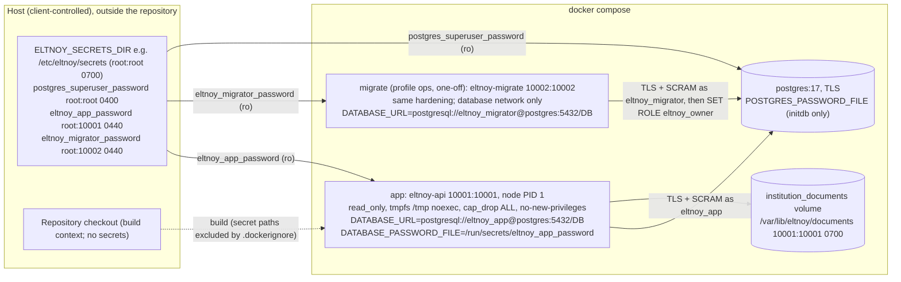

# UD-1: Secure delivery of separate PostgreSQL credentials

> **Historical service names (P1-D.4).** This document records the UD-1-B design. Its references to the `app` service predate P1-D.2, which replaced it with `api_public` and `api_admin`; current production commands are in the operator runbook §14.9 and the README.

**Status:**
- **Implemented in the repository (UD-1-B, uncommitted).** It is validated **in isolated rehearsals only**.
- **Not deployed, not rehearsed on Ubuntu staging, not production-ready.**
- Deploying it **is** the role-separation cutover. That needs OD-P1 approval and the runbook §10 checklist (`docs/operations/production-operator-runbook.md`).

| Rehearsal | What it proved |
|---|---|
| UD-1 `20261104061701-b77055` | Design: Compose file secrets plus `DATABASE_PASSWORD_FILE` (scratch patch). 52/52 checks. |
| UD-1-A `20261104064404-be1099` | Dedicated non-login UIDs, read-only root, native-Linux permission and inode semantics (scratch). 50/50. |
| **UD-1-B `20261104071404-ad7667`** | **The implemented repository files**, production mode, PostgreSQL TLS, nginx, PostgreSQL 17 integration suites, local-dev flow. **80/80.** |

All rehearsals used synthetic data, synthetic random passwords, a synthetic CA and new Docker resources. No existing database or container was used.

---

## 1. Problem (before UD-1-B)
- **The API ran as the superuser.** `docker-compose.yml` built `DATABASE_URL` from `POSTGRES_USER:POSTGRES_PASSWORD`, so the password was visible in `docker inspect`, `docker compose config` and `/proc/<pid>/environ`.
- **No separation.** Migrations ran through the `app` service with the same credential (historical: superseded — the `app` service was split into `api_public` and `api_admin` in P1-D.2).
- **The image ran as `node` (1000)**, the usual first human account on Ubuntu, and **owned `/app/server`, `/app/dist` and `/app/src`**. The API could rewrite its own code.
- **`npm start` was PID 1.** `docker stop` gave exit 1, `npm error signal SIGTERM`, and no graceful shutdown.
- **No ignore rules for secret files.** `.gitignore` and `.dockerignore` did not exclude `secrets/`, `*_password` or `*.pgpass`. A probe build copied them into the image.

## 2. Options considered
| | Compose file secrets | Read-only bind-mounted files | Environment variables | External secret manager |
|---|---|---|---|---|
| In `docker inspect` / `compose config` / `environ` | No (tested) | No | **Yes** (tested) | Depends |
| Per-service scoping | Yes (tested) | Yes | Error-prone | Yes |
| Rotation without restart | Yes, with an in-place rewrite (tested) | Same | No | Yes |
| Extra infrastructure | None | None | None | Needs client approval |

**Chosen: Compose file secrets, with `DATABASE_PASSWORD_FILE` support in the application.**
- **Legacy fallback:** a password inside `DATABASE_URL` still works when `DATABASE_PASSWORD_FILE` is unset. This is for running the API directly in development.
- **External secret manager:** compatible without code changes. Any agent that writes the file (or a symlink to it, unit-tested) works. Adopting one needs client approval.

## 3. Architecture



## 4. Implementation (repository files)
| File | Change |
|---|---|
| `server/databaseCredentials.ts` (new) | `resolveDatabaseCredentials(env)` and `databasePoolConfig(env)`; details below |
| `server/db.ts` | `new Pool(databasePoolConfig(process.env))`. Pool size, timeouts and TLS settings are unchanged. |
| `server/databaseCredentials.test.ts` (new) | 8 unit tests, listed below |
| `server/databaseCredentials.postgres.integration.test.ts` (new) | 4 PostgreSQL tests, skipped unless `ELTNOY_CREDENTIALS_INTEGRATION=1`; listed below |
| `server/containerHardening.test.ts` (new) | 8 static tests of the Dockerfile, Compose and ignore rules |
| `Dockerfile` | Runtime identities, root-owned application files, document root, `USER`, `CMD`; details below |
| `docker-compose.yml` | Hardened `app`, new `migrate` service, file secret for `postgres`; details below |
| `.dockerignore`, `.gitignore` | `secrets/`, `*.secret`, `*_password`, `*_password.txt`, `*.pgpass`, `.pgpass`, `pgpass.conf`. In `.dockerignore` they come after every `!` re-include. |
| `.env.example` | `ELTNOY_SECRETS_DIR` and `DATABASE_PASSWORD_FILE` documented; `POSTGRES_PASSWORD` removed |
| `scripts/test-local-dev-db.sh` | Checks the role-separated dev stack; still non-destructive (read-only transaction) |

**`server/databaseCredentials.ts`:**
- **Without `DATABASE_PASSWORD_FILE`:** `DATABASE_URL` is passed through unchanged (legacy).
- **With `DATABASE_PASSWORD_FILE`:**
  - **The path:** must be absolute.
  - **Conflicts:** the URL must have **no password**; `PGPASSWORD` must be unset.
  - **The URL:** no query parameters (TLS stays on `DATABASE_SSL`). It must name a role, host and database. It is converted to explicit `host`/`port`/`database`/`user` fields, because **node-postgres discards a password function when `connectionString` is also given** (found in UD-1; regression-tested).
  - **The file:** a regular file with **no world permission bits**. Its content is one line of at most 1024 bytes.
  - **When it is read:** once at startup (fail fast), then **again for every new pool connection**.
  - **Errors:** a `DatabaseCredentialError` naming only the variable, the path and the errno code.

**Unit tests (`server/databaseCredentials.test.ts`):**
- legacy pass-through, with a pool config identical to the pre-UD-1 one;
- explicit connection fields;
- `pg.Client`/`pg.Pool` keep the password function (regression);
- conflict rejection;
- invalid URL or path, not echoed;
- missing, unreadable and unsafe files;
- re-reads after an in-place rewrite, a replacement, a symlink and a removal;
- a child process that imports `server/db.ts` with a bad secret exits non-zero and prints no secret or URL.

**Integration tests (`server/databaseCredentials.postgres.integration.test.ts`):**
- connects as a non-superuser probe role, with one file read per connection;
- legacy URL compatibility;
- a wrong password gives `28P01`, with no password in the error;
- rotation by in-place rewrite. The role changes its own password through a client-side SCRAM verifier and restores it.

**`Dockerfile`:**
- **Runtime identities:**
  - locked (`usermod --lock`) system accounts `eltnoy-api` (10001:10001) and `eltnoy-migrate` (10002:10002);
  - `--no-create-home --home-dir /nonexistent --shell /usr/sbin/nologin`;
  - no supplementary groups.
- **Application files stay root-owned** (no `--chown`).
- **`/var/lib/eltnoy/documents` is created 10001:10001 0700.**
- `USER 10001:10001`; `CMD ["node","--import","tsx","server/index.ts"]` (no npm).

**`docker-compose.yml`:**
- **`app`:**
  - `user: "10001:10001"`, `read_only: true`;
  - `tmpfs /tmp:rw,noexec,nosuid,nodev,size=64m,mode=1777`;
  - `cap_drop: [ALL]`, `no-new-privileges:true`;
  - `secrets: [eltnoy_app_password]`;
  - `DATABASE_URL` for `eltnoy_app` with no password, plus `DATABASE_PASSWORD_FILE`;
  - `institution_documents` volume and `INSTITUTION_DOCUMENT_STORAGE_DIR`;
  - `exec node --import tsx server/index.ts`;
  - healthcheck unchanged.
- **New `migrate` service:** profile `ops`, `user: "10002:10002"`, the same hardening, `secrets: [eltnoy_migrator_password]`, the database network only, `node --import tsx server/migrate.ts`.
- **`postgres`:** `POSTGRES_PASSWORD_FILE`, from secret `postgres_superuser_password`.
- **Top-level `secrets:`:** read from `${ELTNOY_SECRETS_DIR:?…}`. Nothing interpolates a password from the environment, and there is no `group_add`.

**Not changed:**
- `server/migrate.ts`, `server/createUser.ts`, `server/index.ts` and the P0-3/P0-4 code;
- nginx;
- `package.json`, which already has `tsx` and `pg` as production dependencies.

## 5. Configuration

### 5.1 Production (`.env.production`, placeholders only)
```dotenv
DEPLOYMENT_MODE=production
APP_HOSTNAME=<client-approved-hostname>
APP_ORIGIN=https://<client-approved-hostname>
POSTGRES_DB=<database name>
POSTGRES_USER=<bootstrap superuser name>
DATABASE_SSL=true
POSTGRES_TLS_DIR=/etc/eltnoy/postgres-tls
POSTGRES_CA_FILE=/etc/eltnoy/postgres-tls/ca.crt
TLS_CERT_DIR=/etc/eltnoy/tls
ELTNOY_SECRETS_DIR=/etc/eltnoy/secrets
# no POSTGRES_PASSWORD and no other password in this file
```
Migrations: `scripts/eltnoy-deploy.sh --deployment-env-file /etc/eltnoy/.env.production migrate` (the deployment wrapper; runbook §14.9). The former direct `docker compose --env-file .env.production --profile ops run --rm migrate` is superseded for production.

### 5.2 Host secret files (Ubuntu; PROPOSED, not executed on any real host)
```sh
sudo install -d -m 0700 -o root -g root /etc/eltnoy/secrets
# Generate each value straight into its file; never echo it.
sudo sh -c 'umask 077; openssl rand -hex 32 > /etc/eltnoy/secrets/eltnoy_app_password'
sudo chown root:10001 /etc/eltnoy/secrets/eltnoy_app_password && sudo chmod 0440 /etc/eltnoy/secrets/eltnoy_app_password
sudo sh -c 'umask 077; openssl rand -hex 32 > /etc/eltnoy/secrets/eltnoy_migrator_password'
sudo chown root:10002 /etc/eltnoy/secrets/eltnoy_migrator_password && sudo chmod 0440 /etc/eltnoy/secrets/eltnoy_migrator_password
# postgres_superuser_password: root:root 0400. On an existing cluster it must hold the CURRENT superuser password.
```
**Groups 10001 and 10002 need not exist on the host.** Numeric ownership is enough. Creating locked host accounts with the same numbers is recommended, so that a later `useradd` can't reuse them (host account creation was not authorized in UD-1-B). **Never add any user to these groups.**

Then set the database passwords to the file values (runbook §2.5).

### 5.3 Local development
- **`.env.development`** needs `ELTNOY_SECRETS_DIR=./.local-dev/secrets`.
- **Secret files:** place the three files there, mode 0400. `.local-dev/` is Git- and Docker-ignored.
- **Before `up`:** run the bootstrap and set the passwords on the local cluster, then run `docker compose --env-file .env.development --profile ops run --rm migrate` (local development only; production uses the wrapper, runbook §14.9).
- **Check:** `bash scripts/test-local-dev-db.sh` (PASS in the UD-1-B rehearsal against a synthetic dev stack). The real local `.env.development` and `eltnoy_dev` were **not** touched.
- **Running the API directly** (`npm run dev:api`): a password in `DATABASE_URL` still works.

## 6. Identity, permission and ownership matrix (as implemented)
| Item | Owner:group | Mode | Visible to | Result in the rehearsal |
|---|---|---|---|---|
| `eltnoy-api` | 10001:10001, locked, `/nonexistent`, nologin | — | API container | `Uid 10001 ×4`, `Groups: 10001`, Cap{Prm,Eff,Bnd,Amb} = 0, NoNewPrivs 1, Seccomp 2 |
| `eltnoy-migrate` | 10002:10002, locked, `/nonexistent`, nologin | — | `migrate` container | `User=10002:10002`, ReadonlyRootfs, CapDrop ALL |
| `/app/**` | 0:0 | 755/644 | both | 0 files not owned by root; nothing under `/app` writable by 10001 or 10002 |
| `/var/lib/eltnoy/documents` (image, then a fresh named volume) | 10001:10001 | 0700 | API | Inherited by the fresh volume; the upload filesystem calls succeed |
| `/tmp` | tmpfs | 1777, `noexec,nosuid,nodev` | both | Writable; executing from it denied |
| `eltnoy_app_password` | root:10001 | 0440 | `app` only | Readable by 10001; **EACCES for 10002** |
| `eltnoy_migrator_password` | root:10002 | 0440 | `migrate` only | Readable by 10002; **EACCES for 10001** |
| `postgres_superuser_password` | root:root | 0400 | `postgres` only | Read by the entrypoint (root) at initdb |
| PostgreSQL TLS key | 999:999 | 0600 | `postgres` | TLS on; every API session over TLS |
| nginx TLS key | 0:101 | 0640 | `nginx` | HTTPS health 200 |
| Root-only (0:0 0400) or wrong-group app secret | — | — | — | API refuses to start: EACCES, non-secret message |
| World-readable app secret | — | 0444 | — | Refused by the application |
| `group_add: [10002]` on the API | — | — | — | **Makes the migrator secret readable** (UD-1-A). Forbidden; a static test asserts there is no `group_add`. |

Compose ignores secret `mode`/`uid`/`gid` outside Swarm. **The host file owner and mode are the only control.**

## 7. Git and build-context exclusion
- **Ignore rules:** `.gitignore` ignores the synthetic credential paths (static test with `git check-ignore`), and does not ignore application or migration files.
- **Build test:** in the UD-1-B rehearsal, the scratch build context was the working tree **plus 11 planted synthetic credential files**, including `public/secrets/leak` (`public/` is re-included by `.dockerignore`). The **build-stage** image (`COPY . .`) contained **none** of them. Migrations, sources and assets were still present.
- **Production practice:** secrets live **outside** the repository (`ELTNOY_SECRETS_DIR`). The ignore rules are defence in depth.

## 8. Rotation and recovery

### 8.1 Rotation
Follow runbook §4.1.

What the rehearsal showed: [TESTED-ISOLATED, UD-1-B, native-Linux file semantics]
- **In-place rewrite** (same inode, owner and mode) is picked up by the next connection, with no restart.
- **Rename-replace** is **not** seen by the running container until it restarts, because single-file bind mounts pin the inode.
- **Between `ALTER ROLE` and the file rewrite,** new connections fail (health 500) while existing connections keep working.

### 8.2 Setting a database password equal to its file
Use one of these (runbook §2.5):
- **[STANDARD]** `\password` from the secret store;
- **[TESTED-ISOLATED]** pipe a SCRAM verifier computed from the file. The rehearsal used a scratch helper; adding one to the repository needs approval.

### 8.3 Backup and restore
- **Dumps:** role passwords are cluster-level, so dumps contain no passwords or verifiers (UD-1).
- **Restore into the same cluster:** the files stay valid.
- **Restore into a new cluster:** the roles exist without passwords after the bootstrap; set them again from the files.
- **`pg_dumpall --roles-only`:** contains SCRAM verifiers, so treat it as a secret.
- **Backups of `ELTNOY_SECRETS_DIR`:** must keep numeric ownership (`tar --numeric-owner`, `rsync --numeric-ids`), and go through the client-approved secret store, never with database dumps.

### 8.4 Failure messages (non-secret) and actions
| Message | Action |
|---|---|
| `DATABASE_PASSWORD_FILE (…) cannot be read (ENOENT)` | Secret missing or not mounted: check `ELTNOY_SECRETS_DIR` and `secrets:` |
| `… cannot be read (EACCES)` | Wrong owner or group: `chown root:10001` (app) or `root:10002` (migrator), `chmod 0440` |
| `… must not be accessible to other users (mode …)` | `chmod 0440` |
| `DATABASE_URL must not contain a password when DATABASE_PASSWORD_FILE is set` / `PGPASSWORD must not be set …` | Remove the conflicting password source |
| `password authentication failed for user "eltnoy_app"` (28P01), health 500 | The database and the file differ: set both again (§8.2); restart if the file was renamed |
| `permission denied for schema public` from a migration | Migration run with the app credential: use the `migrate` service |
| Compose: `Set ELTNOY_SECRETS_DIR …` | Add it to the env file |

## 9. Graceful shutdown and restart [TESTED-ISOLATED, UD-1-B]
- **`docker stop`:** exit **0** in 0.1 s; `{"event":"api.shutdown_started"}` logged; no npm output.
- **`docker restart` and `docker start`:** healthy again.
- **For comparison (UD-1-A):** `npm start` exited 1 with no graceful shutdown; `npm start` with `init: true` exited 143.

## 10. Evidence: UD-1-B rehearsal `20261104071404-ad7667` (80/80)
| Area | Result |
|---|---|
| Pre-flight | No existing resource with the run ID; unique Compose projects; loopback port free; explicit subnets (`10.213.1–4.0/24`), because this host's default Docker address pools are exhausted by earlier rehearsals |
| Image | `USER 10001:10001`; CMD node; both accounts locked, `/nonexistent`, nologin, groups without members; `/app` entirely root-owned; tsx 4.23.15 and pg 8.23.1 present |
| Compose config | Repository `docker-compose.yml` renders alone; the effective config contains no secret value; app/migrate hardening and secret scoping as in §4; postgres has no `POSTGRES_PASSWORD` and no ports; nginx has no secret; no `group_add` |
| PostgreSQL 17 | TLS on; superuser initialised from the 0400 file secret; database network internal; no published port |
| Migration | `docker compose --profile ops run migrate` (rehearsal evidence; superseded for production by the wrapper `migrate` operation, runbook §14.9): one TLS connection as `eltnoy_migrator`; container 10002, read-only, only the migrator secret mounted; rerun idempotent |
| API | Production mode behind nginx, HTTPS health 200; app and nginx healthy; node PID 1; all sessions `eltnoy_app` over TLS; only the app secret visible |
| Privilege | Writes to `/app/server`, `node_modules` and `/etc` denied; `/etc/shadow` unreadable; `chown` to root, `setpriv` to uid 0 and exec from `/tmp` all denied |
| Storage | Fresh volume 10001:10001 0700; upload filesystem calls OK; `institutionDocuments.test.ts` 15/15 inside the read-only API container |
| Functional suite | **46/46** through nginx (role matrix, P0-3, P0-4, concurrency, helpdesk); no container writes; no permission errors |
| Cross-secret access | 10001 cannot read the migrator secret, and 10002 cannot read the app secret, even if mounted (`cat` denied; startup EACCES) |
| Shutdown and restart | §9 |
| Rotation | §8.1 (in place: no restart; rename: stale until restart) |
| Permission failure | Root-only secret: exit 1 with a path + EACCES message; after `chgrp 10001` and `chmod 0440`: healthy |
| PostgreSQL 17 integration | `databaseCredentials` **4/4** (scram over the network, as 10001 read-only); `institutionSubmission.http` **2/2**; `databaseGrants` **8/8** |
| Local development | Synthetic `eltnoy_dev` stack: migration from `.local-dev/secrets`; `scripts/test-local-dev-db.sh` both PASS lines |
| Exposure (0 everywhere) | All container logs including both PostgreSQL servers (7,044 lines); `docker inspect` of 34 containers; Compose config (prod and dev); API and PostgreSQL process environments and command lines; host process list; `docker save` of the runtime and build-stage images; image history; harness logs; Git working tree and history |
| Isolation | All 344 pre-existing Docker records unchanged; Git status, HEAD and the content of every modified/untracked file unchanged during the run; `.env*` metadata unchanged; nothing staged |
| After the run | (rehearsal evidence; the current command is in the README, step 9) `server/createUser.ts` via `docker compose run --rm -it api_public node --import tsx server/createUser.ts …` under a pseudo-terminal: account created as 10001/`eltnoy_app`; password not echoed and not in the PostgreSQL log |

**Repository tests:**
- `npm test`: 547 tests, 533 pass, 0 fail, 14 skipped (the skips are the opt-in integration suites);
- `npm run lint` clean;
- `npm run build` OK.

## 11. Remaining risks and Ubuntu staging requirements
| ID | Risk or untested item | Requirement |
|---|---|---|
| R1 | **Not tested on Ubuntu.** Native-Linux semantics were reproduced on ext4 inside the Docker Desktop VM, not on an Ubuntu host (no AppArmor/SELinux interaction, no host account database) | Repeat the UD-1-B harness on Ubuntu staging |
| R2 | Rename-based secret updates (editors, `sed -i`, `install`, Ansible `copy`/`template`) leave the running API on the old inode | Rotate by in-place rewrite only, or restart; document in the operator procedure |
| R3 | Host accounts or groups with numbers 10001/10002, or members of those groups, could read the secrets | Check `getent passwd/group 10001 10002` on the host (must be empty or locked placeholders) |
| R4 | Host root and the `docker` group can read every secret | Existing trust boundary (OD-P5); restrict group membership |
| R5 | Deploying the new Compose is the cutover; the API can't log in before the bootstrap | OD-P1 approval; runbook §3.4 order; revert = previous Compose (§9 of the runbook) |
| R6 | `POSTGRES_PASSWORD_FILE` is ignored on an existing volume | Put the current superuser password in the file, or rotate with `\password` |
| R7 | Rehearsals logged statements (`log_statement=all`) | UD-8: production log settings |
| R8 | `DATABASE_URL` query parameters are refused in file mode | TLS via `DATABASE_SSL`; revisit only if needed |
| R9 | The health endpoint returns 500 (not 503) while authentication fails | Alert on 5xx from `/api/health` |
| R10 | The legacy env-password path remains, so production could still be misconfigured | A later change could refuse it when `DEPLOYMENT_MODE=production` (needs approval) |
| R11 | No repository helper for "set the database password from the file" | Approve a helper, or use `\password` (runbook §2.5) |
| R12 | The Compose CLI on macOS warns "secret file … does not exist" for VM-internal paths (a rehearsal artefact) | None on a real host; on a real host the path must exist |
| R13 | The external secret manager, the secret store, rotation schedule and custodians (UD-2, UD-3) | Client decision |
