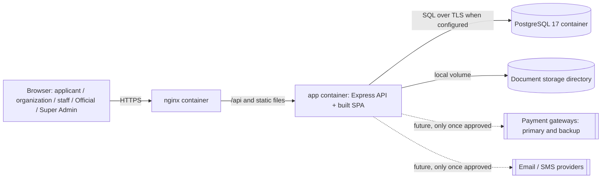
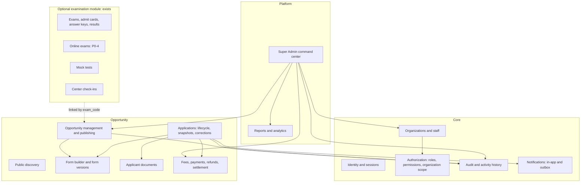

# ELTNOY system architecture

**Status:** Design proposal for review. Nothing here is implemented unless marked "exists". Internal only. Last updated 2026-11-03.
**Policy basis:** `../policy/master-policy-register.md`. Open items are in `../policy/policy-conflict-and-gap-register.md`.
**Data model:** `data-model-final-proposal.md`.

**Status note (2026-11-14), where this design and the code now differ:**
- **Deployment (§3):** the code ships an isolated topology, not one app/nginx/PostgreSQL stack: `api_public` and `api_admin` (listeners 4000/4001), `nginx_public` and `nginx_admin` (Admin bound to the WireGuard address), PostgreSQL with separated roles (`docker-compose.yml`; runbook §14). It is statically tested only, not deployed.
- **P0-3 (§7.1):** largely enforced since commit `df9b93e` (2026-11-04); open: A-08, A-10, A-11, A-12, A-17 (master register, section A note).
- **Authentication (§5.12):** AUTH-1 (Student mobile + password + OTP, Google for linked accounts, Institute mobile/email + institutional verification) and staff identities are built in the uncommitted working tree, all fail-closed without providers (master register sections AU and SM).
- **Invigilators (§5.8):** D-09 is decided by Q117: assigned examination sessions (C-20, `examination-session-module.md`), not centers.
- `server/index.ts` is now about 2,970 lines.

## 1. Product scope

ELTNOY is a **centralized Institution-to-Applicant Application & Opportunity Platform** (P-01, N-01, N-05):

- **Organizations** publish opportunities; **applicants** discover them and apply on ELTNOY; **Super Admin** governs the platform.
- **Organization types** (N-02): educational institutions, government departments, private companies, NGOs and recruitment organizations. Whether the list is closed is C-13.
- **Opportunity types** (N-01): examinations, scholarships, admissions, vacancies, registrations, and custom applications and forms.
- **Examination services are optional modules** (P-02).

**Out of scope by policy:**
- institution subscriptions (N-03);
- custom organization domains or separate institution websites (N-04);
- any third-party SaaS without approval (S-07);
- assuming cloud hosting (S-12).

## 2. Architectural principles

1. **Evolve the existing system; don't rewrite it.** Keep the current React and Vite single-page app, the Express API, PostgreSQL 17 and the Docker Compose stack (app, nginx, PostgreSQL).
2. **Modular monolith.** One deployable app with clear internal modules. No microservices, message brokers or external queues, all of which would add infrastructure that hasn't been approved.
3. **Additive data changes.** New tables sit beside the existing ones. Any change to an existing table is a named exception needing approval (see the data-model proposal §12).
4. **Authorization on the backend** (A-19). The frontend only reflects permissions it receives from the server.
5. **Transactions decide state.** Use one database clock reading, take row locks before reading the clock, use guarded updates, and write the audit entry in the same transaction (A-11, E-02).
6. **Provider-neutral integrations.** Payment, email and SMS sit behind interfaces with no implementation until providers are approved.
7. **Personal data is minimized and classified.** Logs carry IDs and counts only (E-07, S-05). Form fields are marked `none`, `personal` or `sensitive`.
8. **Isolation by design.** Every organization-owned row carries `organization_id`; composite foreign keys keep children inside their organization; the organization in any check comes from the session.

## 3. Deployment view (exists; no cloud assumed)

- The same images run on any host the client chooses (M-10). There's no dependency on managed cloud services.
- **Documents** stay on a local volume, as the existing institution documents do (`INSTITUTION_DOCUMENT_STORAGE_DIR`). Backup and encryption at rest are decision M-10.
- **Background work** (P0-4 recovery, notification fan-out, payment reconciliation) runs as timers inside the app process, using the P0-4 recovery pattern: lock with `SKIP LOCKED`, keep batches small, shut down gracefully. A separate worker process is only needed once load requires it.

## 4. Logical modules

**Server code layout** (recommended, done step by step):
- New modules go in their own files (`server/opportunities/*.ts`, `server/applications/*.ts` and so on), each with a pure core and route handlers, following the P0-4 split into scoring, finalization and recovery.
- `server/index.ts` (2,488 lines) is **not** refactored in one go. Routes move out only when a milestone already changes them.

## 5. Functional architecture

### 5.1 Public opportunity discovery
- **Pages:**
  - public opportunity list, with filters for type, organization type, location, status (open, upcoming, closed) and deadline;
  - opportunity detail page;
  - the in-platform organization profile page, subject to C-14.

  All are served under ELTNOY's own domain (N-04).
- **Open or closed is computed** from the database clock and the published time window, not stored (as P0-4 computes attempt states).
- **Data:** only `published` opportunities from `approved` organizations. Responses carry no personal data.
- **Performance:** indexed listing queries; HTTP caching headers for the public list; no external search service.
- **Existing content:** the `exams` catalogue and approved `institute_forms` stay listed beside the new opportunities until backfill (P-14) is decided.

### 5.2 Organization registration and portal
- **Registration and approval:** keep the existing institution flow: registration, document submission cycles, review history, resubmission. All Officials keep approval authority (A-01).
- **Organization type:** an organization profile adds the type (N-02, D-04) and public profile fields, without changing `users` (§3 of the data model).
- **Portal** (the existing center dashboard, extended):
  - opportunities;
  - applications inbox;
  - documents;
  - payments and wallet;
  - staff and roles;
  - organization activity history (C-03).

### 5.3 Dynamic form builder
- **Building forms:**
  - forms are built from sections and fields of the approved types;
  - validation uses named formats, never regular expressions written by users (D-11);
  - show-if rules are plain data with one level;
  - labels come in five languages.
- **Form versions are immutable once published.** Every application records the version it answered.
- **One validator for both sides.** A single zod definition validates the form itself and validates answers, shared by the server and the frontend (the P0-4 pattern of shared pure logic).
- **Preview:** organizations preview the applicant's view, built with the shared UI components (P-07) and the same accessibility guarantees.

### 5.4 Applicant portal
- The existing candidate account and dashboard are extended:
  - discover and save opportunities;
  - drafts;
  - submission;
  - payment status;
  - correction requests;
  - decisions;
  - notifications.
- Legacy exam applications and new opportunity applications appear in **separate sections** until a combined view is approved (COMP-01).
- Optional module states, such as an admit card being available, come from the module (P-11).

### 5.5 Application lifecycle
- The status set is P-11 (`draft` … `rejected`); transitions are D-16 (pending).
- **One code path for every status change:**
  1. lock the application row;
  2. read the database clock;
  3. check the transition table and the actor's permission;
  4. guarded update;
  5. write a history row and an audit event, all in one transaction.
- **Corrections** reopen only the fields that were requested. Each resubmission is a new immutable snapshot.

### 5.6 Document management
- **Applicant uploads** reuse the hardened institution-document pipeline: the server detects the file type from its content (PDF, JPEG, PNG), enforces a size limit, records a SHA-256 hash, stores the file under a UUID name, and keeps versions append-only.
- **Organization access** is only through an attachment link on that organization's own application; every download is audited.
- **Super Admin only:** institution document downloads and review decisions (A-09).
- **Not implemented:**
  - reuse across applications (P-12);
  - retention and deletion (P-13).
- **Malware scanning** is decision M-13.

### 5.7 Payments and financial workflows
- **Provider-neutral model** (P-15):
  - an order for each amount due;
  - an attempt for each try with each provider (primary, then backup);
  - verified provider events;
  - at most one successful attempt per order.
- **Before providers are approved** (C-15): fees of zero, and offline payments recorded by an authorized organization member.
- **Settlement** to the existing institute wallet. Each credit is a system entry that needs Super Admin approval, pending decision C-02.
- **Withdrawals:** Super Admin only, with maker-checker (A-03).
- **Refunds** use the same order and attempt model. The policy is decision M-07; maker-checker is recommended.
- **No subscriptions** or recurring billing (N-03).

### 5.8 Organization staff and permissions
- **Individual verified staff accounts** (P-10). Organization-defined roles are built from a fixed permission catalogue (D-08) and can never carry platform or Super Admin authority.
- **Organization ownership:** the organization owner (today's center account) holds every organization permission.
- **Invigilators** use the existing check-in function through `exam.checkin.*` permissions, optionally limited to particular centers (D-09).
- **Decisions needed:** D-06, D-07 and D-08, together with C-04, C-11 and C-16.

### 5.9 Super Admin command center
- **Approval queues:**
  - organizations (all Officials, A-01);
  - opportunities (D-27 / PERM-04);
  - documents (Super Admin, A-09).
- **Finance:**
  - wallet credits (A-02);
  - withdrawals with maker-checker (A-03);
  - settlements (C-02);
  - refunds (M-07).
- **Publishing:**
  - results, answer keys, online exams and admit cards (A-04 to A-06, A-16);
  - notices (A-17).
- **Governance:**
  - audit log viewer, Super Admin only (A-12);
  - Official management (A-10, a later milestone; the CLI stays until then);
  - platform settings;
  - categories (D-03).
- **Data:** full export, Super Admin only (A-07).

### 5.10 Notifications
- **In-app notifications** (P-17): written in the same transaction as the event that triggers them; read through a paginated endpoint; marked as read.
- **Email and SMS** use an outbox table and a delivery interface with **no provider** until P-18 is approved. Nothing is sent and no personal data leaves the system.

### 5.11 Reports and analytics
- **Platform reports** for Super Admin. **Organization reports** limited to the organization's own data, by permission.
- **Method:** SQL views and parameterized aggregate queries, with no external analytics service.
- **Charts** use the design-system palette with accessible contrast. Analytics never expose personal data.
- **Exports:** full exports are Super Admin only (A-07). Organization exports are PERM-05.

### 5.12 Security and audit
- **Sessions:** HttpOnly cookies; the origin check on changes (exists); sign-in rate limiting (exists); session revocation when roles or membership change (SEC-09).
- **Authorization helper:** one helper resolves the actor, the organization and the permissions from the session and returns 403 by default. Route tests cover the full matrix (A-19).
- **`audit_events`:** append-only and written in the same transaction as the action (A-11). Readable by Super Admin only (A-12). No automatic deletion (A-13).
- **Logging:**
  - structured logs without personal data;
  - request logging with request IDs (SEC-03).
- **Hardening:**
  - Helmet's Content Security Policy (exists);
  - fonts and assets served from the site itself (P-05);
  - no external requests from pages;
  - the `.dockerignore` fix (P-19).
- **Decisions still open:** two-factor authentication (M-14) and malware scanning (M-13).

### 5.13 Optional examination modules (exist)
- **Existing modules:** exams, applications for exams, admit cards, answer keys and objections, results, mock tests, online exams (P0-4) and center check-ins.
- **They keep running unchanged.** Publishing powers follow A-04 to A-06 once P0-3 is completed.
- **Turning the module on or off per organization** is D-28.
- **Linking an exam to an opportunity** uses `exam_code`. The bridge that would create legacy applications from opportunity applications is D-29 (deferred).
- **Examination Session Management** (C-20, DISCUSSION_APPROVED with Option C) is designed in [`examination-session-module.md`](examination-session-module.md). It adds:
  - structured sessions beside the free-text `exams.shifts` (never parsed);
  - multiple centers and invigilators per session;
  - invigilators limited to their assigned (session, center), enforced on the backend;
  - candidate allocation;
  - QR and manual attendance;
  - monitoring, emergency pause and incidents;
  - append-only assignment, allocation and attendance history;
  - session reports.

  It needs **no change to existing tables**. The legacy `center_checkins` and admit cards keep working unchanged. It sits behind `EXAM_SESSIONS_ENABLED` (off by default). **Pausing an online session doesn't change P0-4 timers** (C-22).

## 6. Frontend architecture

- **Single-page app with path routing.** The existing routes are `/`, `/login/<role>` and `/dashboard/<role>`. New public routes would be `/opportunities` and `/opportunities/:reference`. Any staff route depends on D-06.
- **Design system** (exists):
  - tokens in `src/utils/designTokens.ts` and `src/index.css`;
  - components in `src/components/ui`;
  - the bundled font with Indic fallbacks.
- **Screen changes:** new screens use the shared components. Existing screens are moved only after listing them and getting review (P-08).
- **Languages:** the five existing UI languages, with the form builder's label maps.
- **Accessibility:** WCAG AA contrast is tested; labels and descriptions are tested. A conformance target for the platform is M-15.

## 7. Recommendations

1. **Finish P0-3 first** (C-01 / SEC-01). It's approved policy that the code doesn't enforce, and every new financial or publishing feature depends on it.
2. **Commit P0-4 against its manifest** before touching shared files (C-17).
3. **Build the shared `audit_events` table and authorization helper once** (milestone 2 design, milestone 3 build), and use them for both the P0-3 work and the opportunity platform.
4. **Use reference tables instead of CHECK lists** for statuses, permissions and categories, so later changes stay additive (DB-04).
5. **Ship the opportunity platform behind a feature flag** (D-01). Legacy flows stay fully working until decisions P-14 and D-29 are made.
6. **Keep providers behind interfaces** with no implementation until P-16 and P-18 are approved.
