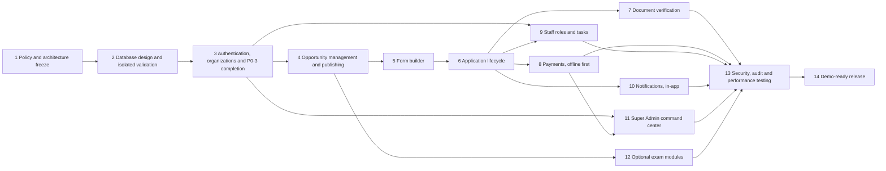

# ELTNOY implementation roadmap

**Status:** Plan for review. No milestone has started. **Every milestone begins only with its own explicit approval** (S-10). Internal only. Last updated 2026-11-03.

**References:**
- policies: `../policy/master-policy-register.md`;
- conflicts and gaps: `../policy/policy-conflict-and-gap-register.md`;
- design: `../architecture/system-architecture.md` and `../architecture/data-model-final-proposal.md`;
- acceptance: `milestone-acceptance-checklist.md`.

**Standing rules for every milestone:**
- No production deployment or migration (S-01).
- No connection to `eltnoy` or `eltnoy_dev`; no port 5432 (S-02).
- Existing containers and volumes untouched (S-03).
- No staging or commits without approval (S-04).
- No secrets in logs or reports (S-05).
- Synthetic data only (S-06).
- No SaaS without approval (S-07).
- P0-4 checksums are verified at the start and end of every milestone until P0-4 is committed.

## Sequence and dependencies

**The critical path is M1 → M2 → M3 → M4 → M5 → M6 → M13 → M14.** M7, M8, M9, M10 and M12 can run in parallel after their dependencies are met.

---

## M1: Policy and architecture freeze

- **Dependencies:** none.
- **Deliverables:**
  - The register verified against Q1–Q125 (M-01, M-02).
  - Answers to the decisions that block M2 and M3:
    - the final review of the revised P0-3 plan (M-03);
    - D-04, D-06, D-07, D-08, D-10, D-16, D-32;
    - C-02, C-03, C-04, C-16.
  - The P0-4 commit, after Git approval, checked against the 21-file manifest (C-17).
  - Cleanup of the isolated test environment, after approval (R-14, SEC-06).
- **Backend, frontend and database:** none. Documentation only.
- **Tests:** checksum verification of the P0-4 commit; the full suite (416 tests, 2 skipped) still passes.
- **Acceptance:** every decision blocking M2 and M3 is `DISCUSSION_APPROVED` or `IMPLEMENTATION_APPROVED`, or explicitly deferred; no `CONFLICTING` entry remains for M2 or M3.
- **Risks:**
  - Q1–Q114 may contradict decisions recorded here. They are merged as CONFLICTING and not overwritten.
  - Unanswered decisions delay M2.

## M2: Database design and isolated validation

- **Dependencies:** M1.
- **Deliverables:**
  - The migration SQL for the audit table and the P0-3 columns (X-04 to X-07).
  - The SQL for the opportunity core (§4.1, §4.3, §4.4), the documents (§4.5) and the payments (§4.6, offline only).
  - **Not yet run** against any shared database.
  - An isolated validation report.
- **Backend:** add the migration files to `server/migrate.ts`, behind the feature flag (D-01).
- **Frontend:** none.
- **Database:** an isolated PostgreSQL 17 with no port 5432, following the Phase 7 harness rules.
- **Tests:**
  - the migration runs twice;
  - existing table definitions byte-identical (except the approved X items);
  - cross-organization foreign-key rejections;
  - append-only triggers block UPDATE, DELETE and TRUNCATE;
  - the seed data is correct;
  - the rollback rehearsal (flag off) leaves legacy flows working.
- **Acceptance:** every check in the checklist passes; the report is reviewed; no production change.
- **Risks:** DB-01 to DB-07; the X-04 legacy backfill for maker-checker.

## M3: Authentication, organization management and P0-3 completion

- **Dependencies:** M2, plus approval of the revised P0-3 plan.
- **Deliverables:**
  1. **P0-3 enforced (C-01):** A-02 to A-17 on the backend, the `audit_events` writes (A-11), the Super Admin audit viewer (A-12), and A-08 hiding contact details.
  2. The organization profile and type (N-02).
  3. The authorization helper for organization scope.
  4. Request logging (SEC-03); the loopback bind outside Docker (SEC-04), with approval.
- **Backend:**
  - route guards;
  - maker-checker transactions (A-03);
  - draft and publish flows (A-04 to A-06, A-16, A-17);
  - audit inside each change's transaction;
  - organization profile endpoints.
- **Frontend:** hide Super Admin-only controls from ordinary Officials (behaviour stays enforced on the backend). Affected screens are listed and reviewed first (P-08).
- **Database:** the M2 migrations X-04 to X-07, `audit_events` and `organization_profiles`, applied to isolated environments only.
- **Tests:**
  - a route matrix: unauthenticated, wrong role, ordinary Official and Super Admin on every admin route (A-19);
  - maker-checker, including legacy rows;
  - an audit failure rolls the action back;
  - draft and publish;
  - regression of A-01 and A-18.
- **Acceptance:** zero admin routes open to ordinary Officials contrary to section A; the audit entry and the action are in the same transaction on every audited route.
- **Risks:** the admit-card mixed-version risk (A-20); changing behaviour Officials rely on. Mitigation: controlled deployment notes.

## M4: Opportunity management and publishing

- **Dependencies:** M3. Decisions D-02, D-03, D-26, D-27, PERM-04 and C-14.
- **Deliverables:**
  - opportunity creation, editing and submission by organizations;
  - the review queue;
  - publish, withdraw and archive;
  - public discovery pages (§5.1);
  - the organization profile page, if C-14 is approved.
- **Backend:**
  - opportunity endpoints;
  - review transitions with append-only history;
  - "open" computed from the database clock;
  - a paged public listing.
- **Frontend:**
  - an organization opportunity editor built from the shared components;
  - the public list and detail pages;
  - the reviewer queue.
- **Database:** `opportunities`, `opportunity_review_history`, `opportunity_categories` and `organization_types`.
- **Tests:**
  - every review transition;
  - unpublished or unapproved organizations never appear publicly;
  - cross-organization isolation;
  - the window boundaries (opening and closing to the microsecond, by the database clock);
  - accessibility tests on the new screens.
- **Acceptance:** an end-to-end flow on synthetic data: organization drafts, reviewer approves, the opportunity is published, it appears publicly, and it closes on time.
- **Risks:** PERM-04 undecided; legacy `institute_forms` shown alongside (COMP-03).

## M5: Dynamic form builder

- **Dependencies:** M4. Decisions D-11 and D-12.
- **Deliverables:**
  - the form-schema definition (zod, shared by the server and the frontend);
  - the builder interface;
  - preview;
  - version publishing (immutable).
- **Backend:** form validation, version publishing, the immutability trigger.
- **Frontend:** the builder (sections, fields, the approved types, show-if rules, five-language labels) and the preview.
- **Database:** `opportunity_form_versions`.
- **Tests:**
  - the schema validator against valid and invalid fixtures;
  - no regular expressions or executable expressions accepted;
  - size limits;
  - a published version can't be changed;
  - the answer validator against the schema;
  - accessibility of generated forms (labels, descriptions, errors).
- **Acceptance:** a form built and published on synthetic data renders identically in the preview and the applicant view, and validates the same way on the server and the client.
- **Risks:** scope growth (conditional logic); the five-language content.

## M6: Applicant application lifecycle

- **Dependencies:** M5. Decisions D-13, D-14, D-16, D-17 and D-32.
- **Deliverables:**
  - drafts, submission, snapshots, status history, correction requests and resubmission;
  - the applicant portal section;
  - the organization applications inbox.
- **Backend:** one transition engine (lock, then the database clock, then the transition table, then a guarded update, then history and audit in one transaction).
- **Frontend:**
  - applicant drafts and submission;
  - status timeline;
  - the correction view, editing only the requested fields;
  - the organization inbox (a data table) and decision actions;
  - `StatusBadge` mappings (COMP-05).
- **Database:** applications, versions, status history, correction requests, `application_statuses`.
- **Tests:**
  - every status pair for every actor;
  - simultaneous transitions produce exactly one change;
  - submitting after closing is rejected;
  - changing fields outside the correction request is rejected;
  - history is append-only;
  - legacy exam applications and P0-4 untouched (regression).
- **Acceptance:** every approved transition works and every other one is rejected with no write; P0-4 suite green.
- **Risks:** the D-16 open questions; the vocabulary mismatch with legacy statuses (C-09).

## M7: Document verification

- **Dependencies:** M6. Decisions D-20 and M-13. (P-12 and P-13 are **not** implemented.)
- **Deliverables:**
  - applicant uploads through the hardened pipeline;
  - attachments linked to snapshots;
  - organization review of attachments;
  - audited downloads.
- **Backend:** reuse the institution-document detection, size, hash and storage code; access only through attachment links.
- **Frontend:** the upload control (accessible, with progress and error states) and the document viewer for permitted members.
- **Database:** `applicant_files` and `opportunity_application_attachments`.
- **Tests:**
  - content-type detection (spoofed extensions rejected);
  - size limits;
  - organization B can't fetch organization A's files;
  - a file already attached elsewhere is refused (no reuse);
  - every download writes an audit event.
- **Acceptance:** every test passes; there's no path to a file except an attachment link on the organization's own application.
- **Risks:** storage growth on the local volume (M-10); malware scanning undecided (M-13).

## M8: Payments and financial workflows

- **Dependencies:** M6. Decisions M-07, M-08, C-02, D-23 and D-33. **Providers (P-16) are not needed for the offline scope.**
- **Deliverables:**
  - fee definitions;
  - payment orders and attempts;
  - offline verification;
  - settlement proposals with Super Admin approval;
  - refunds, if M-07 is decided;
  - the provider interface with **no implementation**.
- **Backend:**
  - the order and attempt engine;
  - the "at most one success" guard;
  - idempotency keys;
  - settlement into `institute_wallet_entries` within one transaction;
  - maker-checker for refunds and settlement approval.
- **Frontend:**
  - applicant payment status;
  - the organization's offline-verification screen;
  - the Super Admin settlement and refund queues.
- **Database:** §4.6 (`payment_providers` stays empty).
- **Tests:**
  - a second success is rejected or flagged;
  - two people verifying at the same time produce one success;
  - refunds can't exceed the amount paid;
  - maker-checker;
  - settlement and wallet entry in one transaction;
  - the wallet and withdrawal regression (A-03).
- **Acceptance:** applications with and without a fee complete on synthetic data, with consistent order, attempt and wallet totals.
- **Risks:** the C-02 policy; the gateway integration is a later, separate milestone once P-16 is decided.

## M9: Staff roles and task management

- **Dependencies:** M3 and M6. **Approval of D-06 (X-01), D-07 and D-08**, plus C-04, C-11 and C-16.
- **Deliverables:**
  - staff accounts (`role = 'staff'`);
  - invitations and activation;
  - organization roles built from the catalogue;
  - member management;
  - permission-checked routes;
  - organization activity history (C-03);
  - task views (applications assigned or filtered by permission).
- **Backend:**
  - the X-01 migration;
  - permission resolution;
  - escalation guards;
  - session revocation on suspension or removal (SEC-09);
  - `role` updates in sign-in, the CLI and the fixtures (COMP-02).
- **Frontend:**
  - staff sign-in;
  - the staff dashboard route;
  - role editor;
  - member list.
  - Affected screens are listed first (P-08).
- **Database:** §4.2, plus X-01 and X-02.
- **Tests:**
  - every existing role route returns 403 to staff;
  - `requireSuperAdmin` returns 403 to staff;
  - unverified or suspended members get 403;
  - escalation guards;
  - an invitation token is single-use and expires;
  - cross-organization;
  - a staff row created without a status can't sign in.
- **Acceptance:** the full permission matrix passes; no staff path reaches platform authority.
- **Risks:** DB-01 (one-way); the frontend role handling (COMP-02).

## M10: Notifications and communication

- **Dependencies:** M6. P-17 approved; **P-18 not needed** for in-app notifications.
- **Deliverables:**
  - in-app notifications for the application, review and payment events;
  - the notification center;
  - the outbox schema with **sending disabled**.
- **Backend:** notifications written in the same transaction as their event; paged reads; marking as read.
- **Frontend:** a notification bell and list (accessible, with a polite live region for new items).
- **Database:** `notifications` and `notification_deliveries` (no rows written).
- **Tests:**
  - a rolled-back event creates no notification;
  - users see only their own;
  - no outbox rows and no outbound network calls.
- **Acceptance:** every approved event produces exactly one notification to the right recipient.
- **Risks:** applicant password reset isn't possible without email or SMS (NOT-05).

## M11: Super Admin command center

- **Dependencies:** M3 and M8 (M4, M7 and M9 for the full set of queues). Decision A-10 for Official management.
- **Deliverables:**
  - one command center with:
    - approval queues for organizations, opportunities and documents;
    - finance (credits, withdrawals, settlements, refunds);
    - publishing;
    - the audit viewer;
    - categories (D-03);
    - platform reports;
  - **Official management** (A-10: create, Super Admin grant and revoke, disable, session revocation) as its own approved sub-milestone.
- **Backend:** aggregate endpoints, Super Admin only where section A requires it; Official management APIs (designed and approved first, per A-10).
- **Frontend:** the command-center layout using the design system (tables, filters, empty and error states, charts with the accessible palette).
- **Database:** none beyond earlier milestones. Reporting views as needed.
- **Tests:**
  - the Super Admin-only matrix;
  - report figures equal source-table counts on fixtures;
  - no personal data in aggregates.
- **Acceptance:** every Super Admin action from section A is reachable, audited and refused to ordinary Officials.
- **Risks:** the size of the existing `RolePortal.tsx` (1,591 lines). Screens move one at a time, each with review.

## M12: Optional examination modules

- **Dependencies:** M4, and M3 for A-04 to A-06. Decisions D-28 and D-29.
- **Examination Session Management** (N-07 / C-20 Option C): phases ES-0 to ES-10 in `../architecture/examination-session-module.md` §12. ES-5 (invigilator assignments) also depends on M9 and on C-18 / D-06.
- **Deliverables:**
  - per-organization module enablement (if D-28 is approved);
  - linking an exam to an `examination` opportunity;
  - the existing modules working unchanged, with P0-3 publishing rules;
  - invigilator check-ins through staff permissions (with M9).
- **Backend:** module gating; `opportunity_exam_links`; **no change to P0-4 behaviour.**
- **Frontend:** exam menus hidden where the module is disabled.
- **Database:** `opportunity_exam_links` (and the D-28 table, if approved).
- **Tests:**
  - the full P0-4 suite and the Phase 7 scenarios rerun in isolation;
  - module gating;
  - linking an exam doesn't change the legacy application flow.
- **Acceptance:** P0-4 evidence still holds; exam features are invisible to organizations without the module.
- **Risks:** COMP-01 (P0-4 depends on legacy applications); the D-29 bridge deferred.

## M13: Security, audit and performance testing

- **Dependencies:** M7 to M12.
- **Deliverables:**
  - a security review (authorization matrix, isolation, file handling, sessions);
  - audit completeness;
  - performance tests on synthetic volumes;
  - an accessibility audit (M-15);
  - a dependency audit;
  - a build-context check.
- **Backend:** fixes for findings, each separately approved.
- **Frontend:** fixes for accessibility findings.
- **Database:** query plans for the §5 indexes on synthetic volume.
- **Tests:**
  - an automated route-matrix sweep;
  - cross-organization fuzzing on synthetic data;
  - load: public listing, inbox, submission and the P0-4 recovery sweep;
  - restore rehearsal (M-10);
  - the `.dockerignore` verification (P-19, SEC-05).
- **Acceptance:** no critical or high findings open; agreed performance targets met; the audit covers every A-11 category.
- **Risks:** the performance targets aren't defined yet (to be set in M1).

## M14: Demo-ready release

- **Dependencies:** M13. Decisions M-10 (hosting) and M-11 (name).
- **Deliverables:**
  - a demo environment (isolated, synthetic data, on hosting approved by the client; **no cloud assumed**, S-12);
  - release notes;
  - runbooks (migration, rollback by flag, restore, test-environment cleanup);
  - the final evidence pack.
- **Backend and frontend:** a release-candidate build from a verified build context.
- **Database:** migrations applied **only** to the demo database, with approval.
- **Tests:** the full suite; Phase 7-style end-to-end scenarios for every module; a browser check on the target devices, including Windows and Android font fallbacks (left unproven in the 2026-11-03 font check).
- **Acceptance:** every checklist item signed off; the client approves the demo.
- **Risks:** a production release is **not** part of M14 and needs separate authorization (S-01, R-11).
